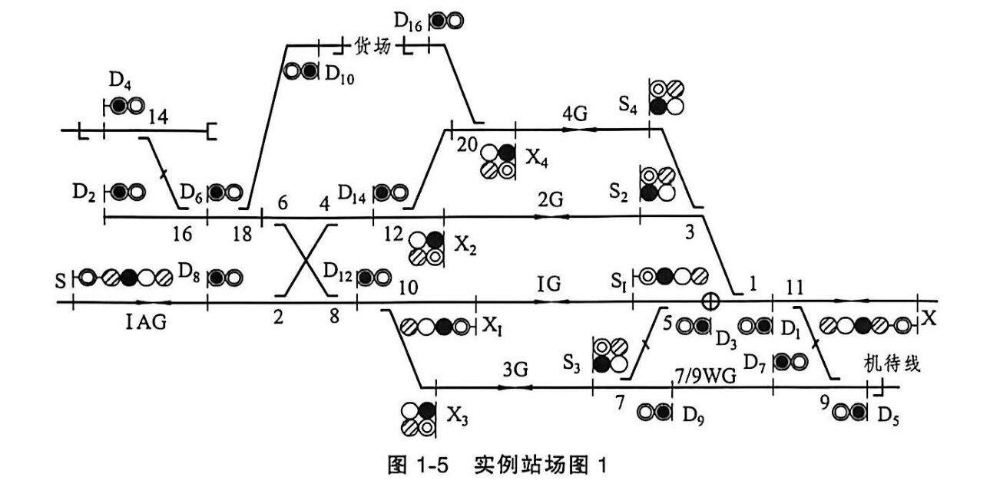
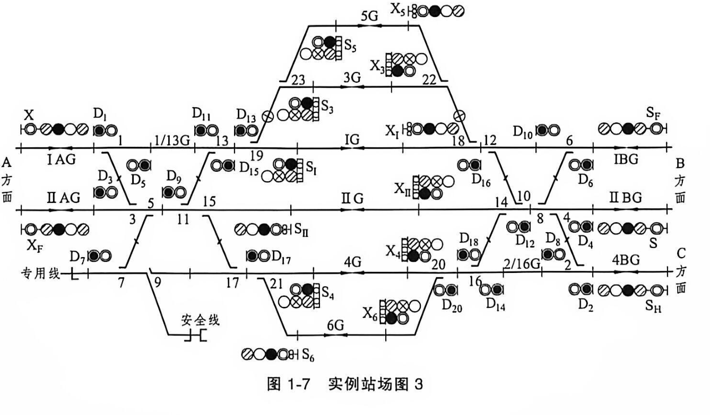
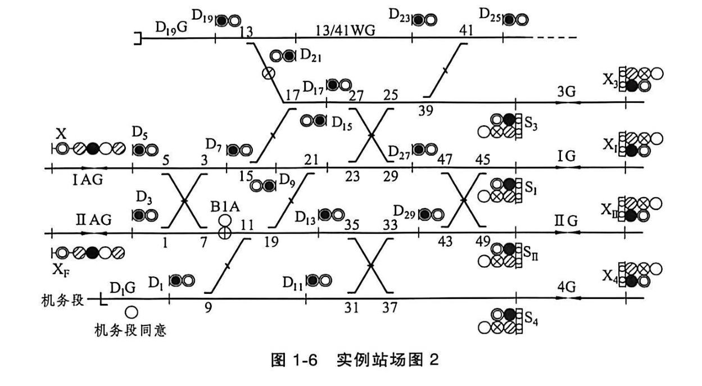
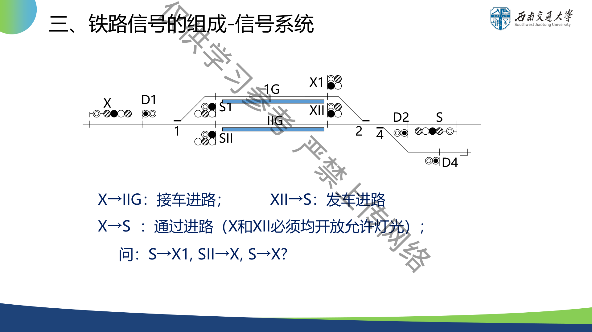
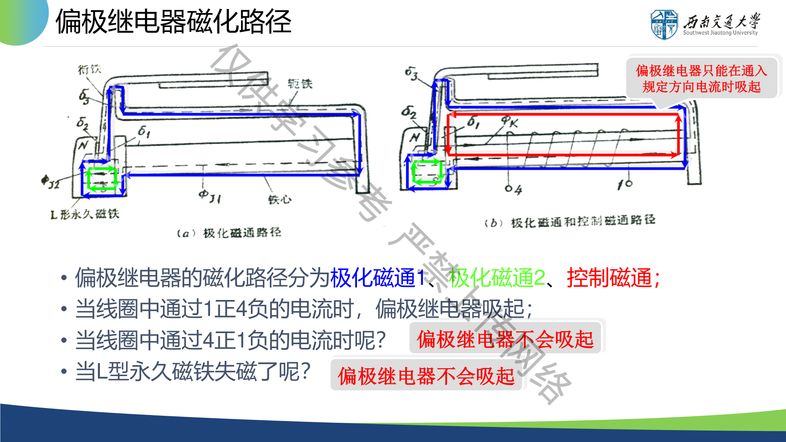
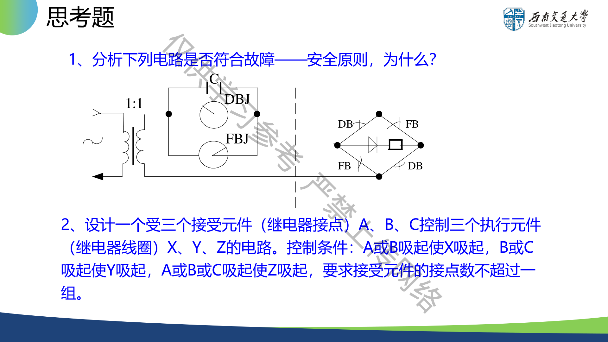
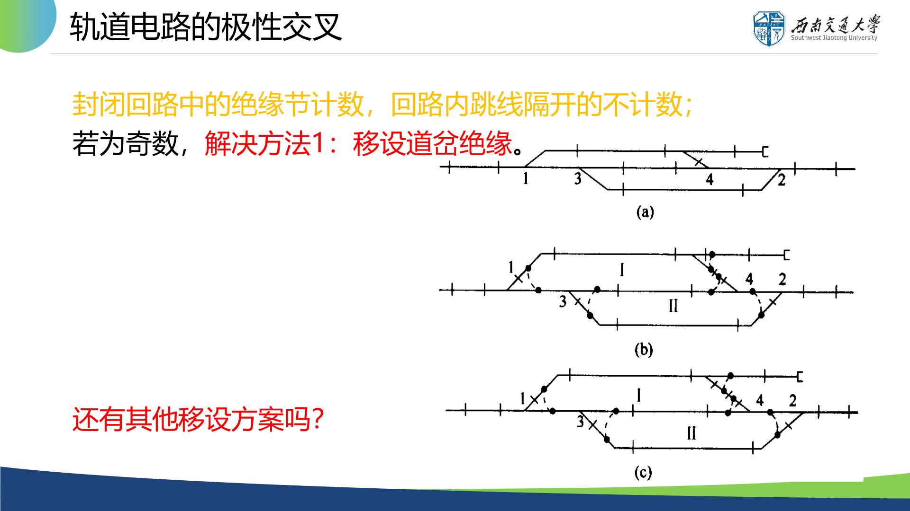
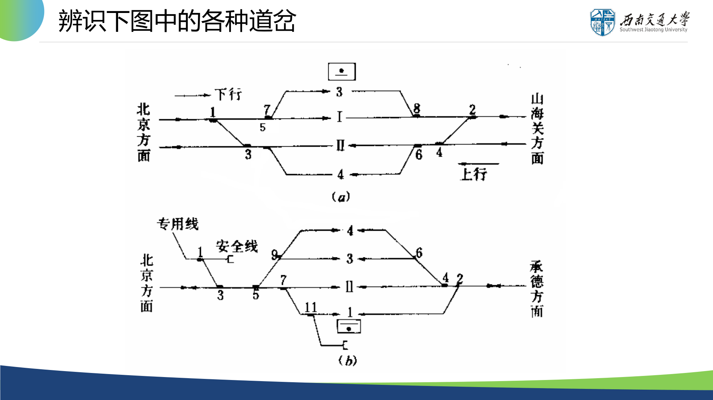

# 车站联锁仿真教学软件六章题库

整理日期：2026年11月2日。共226题，其中客观题184题、主观备选题42题。

题目忠实摘录；不是模型自编题。暂无可靠答案的题保留待核对，部分答案不算整题已答。网上题为城市轨道交通2022年公开考核题，仅作拓展，不等同国铁6502现行操作规程。

## 第1章 进路选择与设备操作

进路办理、按钮顺序、设备辨识和选择组动作。原课件中的继电器细节保留其6502教学背景。

### C1-005 填空题

信号机的作用是________。调车信号机平时点________色的禁止灯光，此时，调车信号继电器DXJ和灯丝继电器DJ分别处于________、________状态；调车进路建立好之后，调车信号机点亮________色的允许灯光，此时，调车信号继电器DXJ和灯丝继电器DJ分别处于________、________状态。列车信号机平时点________色的禁止灯光，此时，灯丝继电器DJ处于________状态，列车信号继电器LXJ处于________状态。出站兼调车信号机平时点________色的禁止灯光。

答案：待核对，现有资料未提供可直接采用的完整答案。
状态：部分空位已有依据 其余待核对
部分空位答案：信号机作用：为指示列车运行及调车作业的命令，形成信号显示，指示列车运行条件。；调车禁止灯光：蓝；调车允许灯光：月白；列车信号机平时禁止灯光：红；出站兼调车平时禁止灯光：红
来源：L04 习题.pdf，PDF第1页，原题2-1
答案依据：L01 第24页；L03 第64页；L03 第91页
整理备注：仅直接支持题中灯色及信号机作用；DXJ、DJ、LXJ各空无直接课件证据，不予作答。

### C1-006 填空题

道岔的作用是________。道岔的位置可以用道岔定位表示继电器DBJ和反位表示继电器FBJ的状态来反映：当道岔表示继电器DBJ和FBJ分别处于________状态和________状态时，反映道岔处于定位；当道岔表示继电器DBJ和FBJ分别处于________状态和________状态时反映道岔处于反位；当道岔表示继电器DBJ和FBJ分别处于________状态和________状态时反映道岔处于四开状态。当道岔锁闭继电器SJ处于________状态时，反映该道岔已经锁闭，道岔不能进行转换；当道岔锁闭继电器SJ处于________状态时，反映该道岔处于解锁状态，能够进行转换。当道岔转换超过________s时，视为道岔转换出现故障，应该进行报警。

答案：待核对，现有资料未提供可直接采用的完整答案。
状态：部分空位已有依据 其余待核对
部分空位答案：道岔作用：使机车车辆由一条线路转入另一条线路或跨越其他线路。
来源：L04 习题.pdf，PDF第1页，原题2-2
答案依据：L07 第3页
整理备注：仅支持“道岔作用”一空；DBJ/FBJ/SJ状态、转换超时秒数均无直接来源，不予作答。

### C1-007 填空题

轨道电路的作用是________。轨道电路的状态可以用继电器________来反映，当其吸起时反映________，而其落下时反映________。

答案：监督列车的占用，传递行车信息；轨道继电器（DGJ）；该段线路空闲；该段线路有车占用
状态：课件可核对答案
来源：L04 习题.pdf，PDF第2页，原题2-3
答案依据：L06 第6页；L06 第7页；L06 第9页
整理备注：扫描续页印刷p29。DGJ缩写见扫描本题所处章节，课件明确写“轨道继电器”；使用中文全名可直接证明，缩写不依赖课件推定。

### C1-009 填空题

在图1-5所示的站场中，单置信号机有________，差置信号机有________，尽头信号机有________，进站信号机有________，出站兼调车信号机有________，高柱信号机有________；正线股道有________，无岔区段有________，牵出线有________；单动道岔有________，双动道岔有________，交叉渡线道岔有________。

图1-5题设：X和S与邻站之间均采用单线双向半自动闭塞制式。

答案：待核对，现有资料未提供可直接采用的完整答案。
状态：待核对
来源：L04 习题.pdf，PDF第3页，原题5-1
答案依据：尚未找到可靠完整答案

### C1-010 填空题

在图1-7所示的站场中，单置信号机有________，并置信号机有________，差置信号机有________，尽头信号机有________，进站信号机有________，出站兼调车信号机有________，高柱信号机有________；正线股道有________，无岔区段有________，牵出线有________；单动道岔有________。

图1-7题设：A、B方向采用双线双向四显示自动闭塞，C方向采用单线双向半自动闭塞；各股道均能对A、B、C方向接车。

答案：待核对，现有资料未提供可直接采用的完整答案。
状态：待核对
来源：L04 习题.pdf，PDF第6页，原题7-1
答案依据：尚未找到可靠完整答案

### C1-011 判断题

可以通过按压XLA和SFLA来建立正线通过进路。

图1-7题设：A、B方向采用双线双向四显示自动闭塞，C方向采用单线双向半自动闭塞；各股道均能对A、B、C方向接车。

答案：待核对，现有资料未提供可直接采用的完整答案。
状态：待核对
来源：L04 习题.pdf，PDF第7页，原题7-11-9
答案依据：尚未找到可靠完整答案

### C1-017 填空题

根据图1-5，建立S3经5/7定位至D5的长调车进路，一次办理时应该按顺序按下按钮________。分段办理时应该先按顺序先按下________按钮，后按顺序按下________按钮；建立S3经5/7反位至D5的变通进路时，应该按顺序按下________按钮。

图1-5题设：X和S与邻站之间均采用单线双向半自动闭塞制式。

答案：待核对，现有资料未提供可直接采用的完整答案。
状态：待核对
来源：L05 第二章作业.pdf，PDF第1页，原题2-1
答案依据：尚未找到可靠完整答案

### C1-018 填空题

根据图1-5，将2G中机车经信号机D1折返到ⅠG上，应该先按顺序按下________按钮来建立牵出进路，待机车完全牵出到D1外方的11DG后，再按顺序按下________按钮来建立调车折返进路，将机车折返到ⅠG上。

图1-5题设：X和S与邻站之间均采用单线双向半自动闭塞制式。

答案：待核对，现有资料未提供可直接采用的完整答案。
状态：待核对
来源：L05 第二章作业.pdf，PDF第1页，原题2-2
答案依据：尚未找到可靠完整答案

### C1-019 填空题

根据图1-5，要将3G上机车经上行咽喉调到货场，可以通过首先按顺序按下________按钮来建立牵出进路，待机车到达D6外方的16DG后，再按顺序按下________按钮来建立调车折返进路，将机车折返到货场中。

图1-5题设：X和S与邻站之间均采用单线双向半自动闭塞制式。

答案：待核对，现有资料未提供可直接采用的完整答案。
状态：待核对
来源：L05 第二章作业.pdf，PDF第1页，原题2-3
答案依据：尚未找到可靠完整答案

### C1-020 填空题

根据图1-5，现想将进站信号机X外方列车接车到ⅠG，将列车上机车调入到3G上，换上暂停在7/9WG上的机车，最后将组装好的列车由S1发车。车站操作员应该执行的操作是：首先按顺序按下________按钮来建立下行正线接车进路；待列车完全进入ⅠG并摘钩后，按顺序按下________按钮来建立牵出进路；待卸下的机车完全进入D12外方的2-8DG后，顺序按下________按钮来建立折返进路，将机车调入到3G上。组装新机车时，应该按顺序按下________按钮来建立牵出进路；待机车完全牵出到D5外方后，再按顺序按下________按钮来建立调车折返进路；待机车折返到ⅠG并组装好之后，再按顺序按下________按钮来建立正线发车进路，进行发车作业。

图1-5题设：X和S与邻站之间均采用单线双向半自动闭塞制式。

答案：待核对，现有资料未提供可直接采用的完整答案。
状态：待核对
来源：L05 第二章作业.pdf，PDF第2页，原题2-4
答案依据：尚未找到可靠完整答案

### C1-021 填空题

根据图1-5，S外方的列车经本站不停站而通过时，可以通过顺序按下________按钮来建立正线通过进路；也可以分段办理，先顺序按下________按钮来建立正线发车进路，然后顺序按下________按钮来建立正线接车进路。

图1-5题设：X和S与邻站之间均采用单线双向半自动闭塞制式。

答案：待核对，现有资料未提供可直接采用的完整答案。
状态：待核对
来源：L05 第二章作业.pdf，PDF第2页，原题2-5
答案依据：尚未找到可靠完整答案

### C1-023 填空题

根据图1-6，建立S4经35/37反位到D1的变通进路时，需顺序按下________按钮。在1-7DG和11-19DG之间设置B1A的原因是________。

图1-6题设：X和XF与邻站之间采用双线双向四显示自动闭塞制式，ⅠG、ⅡG、3G、4G均可向两个咽喉发车。

答案：待核对，现有资料未提供可直接采用的完整答案。
状态：待核对
来源：L05 第二章作业.pdf，PDF第2页，原题3-1
答案依据：尚未找到可靠完整答案

### C1-024 填空题

根据图1-6，对D19至ⅡG的长调车进路，一次办理时需顺序按下________按钮；分段办理时，需顺序按下________按钮。

图1-6题设：X和XF与邻站之间采用双线双向四显示自动闭塞制式，ⅠG、ⅡG、3G、4G均可向两个咽喉发车。

答案：待核对，现有资料未提供可直接采用的完整答案。
状态：待核对
来源：L05 第二章作业.pdf，PDF第2页，原题3-2
答案依据：尚未找到可靠完整答案

### C1-025 填空题

根据图1-6，在锁闭继电器SJ处于吸起状态时，若想人工将道岔9/11扳到反位，需按下按钮________；如果是要将其扳到定位，则需按下按钮________；如需将其单锁，则执行的操作是________。

图1-6题设：X和XF与邻站之间采用双线双向四显示自动闭塞制式，ⅠG、ⅡG、3G、4G均可向两个咽喉发车。

答案：待核对，现有资料未提供可直接采用的完整答案。
状态：待核对
来源：L05 第二章作业.pdf，PDF第2页，原题3-4
答案依据：尚未找到可靠完整答案

### C1-027 填空题

根据图1-7，当5/7道岔在空闲状态时，要单操该道岔到定位，需同时按下按钮________；要单操该道岔到反位，需同时按下按钮________。如果该道岔正在维修，值班员可以采用________操作来防止该道岔动作。

图1-7题设：A、B方向采用双线双向四显示自动闭塞，C方向采用单线双向半自动闭塞；各股道均能对A、B、C方向接车。

答案：待核对，现有资料未提供可直接采用的完整答案。
状态：待核对
来源：L05 第二章作业.pdf，PDF第3页，原题4-2
答案依据：尚未找到可靠完整答案

### C1-028 填空题

道岔在定位时，控制台上道岔位置表示灯显示________色；道岔在反位时，其道岔位置表示灯显示________色；道岔在四开状态时，其道岔位置表示灯显示________色。

图1-7题设：A、B方向采用双线双向四显示自动闭塞，C方向采用单线双向半自动闭塞；各股道均能对A、B、C方向接车。

答案：待核对，现有资料未提供可直接采用的完整答案。
状态：待核对
来源：L05 第二章作业.pdf，PDF第3页，原题4-3
答案依据：尚未找到可靠完整答案

### C1-032 填空题

根据图1-5，选排D6至D12的调车进路时，在1～6网路线中最先开始工作的是________网路线，最后开始工作的是________网路线，1～6网路线选路结束后保持吸起的继电器有________。如果选排的是D6至3G的长调车进路，则1～6网路线选路结束后保持吸起的继电器有________。

图1-5题设：X和S与邻站之间均采用单线双向半自动闭塞制式。

答案：待核对，现有资料未提供可直接采用的完整答案。
状态：待核对
来源：L08 照片，原书第95页，原题2-1
答案依据：尚未找到可靠完整答案

### C1-033 填空题

根据图1-5，选排S至X的正线通过进路时，如果采用一次办理，需要按下按钮________和________，在1～6网路线选路结束后保持吸起的继电器有________。

图1-5题设：X和S与邻站之间均采用单线双向半自动闭塞制式。

答案：待核对，现有资料未提供可直接采用的完整答案。
状态：待核对
来源：L08 照片，原书第95页，原题2-2
答案依据：尚未找到可靠完整答案

### C1-034 填空题

根据图1-5，假定道岔2/4在定位、6/8在反位，则选排S至2G的接车进路时，在1～6网路线中，最先开始工作的是________网路线，1～6线工作完成之后，信号S的组合中保持吸起的继电器有________，该进路中最先开始转换的道岔是________，道岔2/4和6/8不能同时转换的原因是________。

图1-5题设：X和S与邻站之间均采用单线双向半自动闭塞制式。

答案：待核对，现有资料未提供可直接采用的完整答案。
状态：待核对
来源：L08 照片，原书第95页，原题2-3
答案依据：尚未找到可靠完整答案

### C1-035 填空题

根据图1-5，选排D2至ⅠG的长调车进路时，1～6线工作完成之后仍然保持吸起的继电器有________。

图1-5题设：X和S与邻站之间均采用单线双向半自动闭塞制式。

答案：待核对，现有资料未提供可直接采用的完整答案。
状态：待核对
来源：L08 照片，原书第95页，原题2-4
答案依据：尚未找到可靠完整答案

### C1-038 判断题

根据图1-5，对上行往3G的接车进路，在进路中各个信号设备都满足选路条件的情况下，按压SLA、D12A和X3LA这三个按钮，也能将该进路选排出来。

图1-5题设：X和S与邻站之间均采用单线双向半自动闭塞制式。

答案：待核对，现有资料未提供可直接采用的完整答案。
状态：待核对
来源：L08 照片，原书第95页，原题3-1
答案依据：尚未找到可靠完整答案

### C1-039 判断题

根据图1-5，对D5经道岔9/11定位至S3的长调车进路，由远及近分段选排该进路与一次排列该长调车进路，选路时在1～6网路线上所检查的联锁条件完全相同。

图1-5题设：X和S与邻站之间均采用单线双向半自动闭塞制式。

答案：待核对，现有资料未提供可直接采用的完整答案。
状态：待核对
来源：L08 照片，原书第95页，原题3-3
答案依据：尚未找到可靠完整答案

### C1-040 判断题

根据图1-5，选排S至2G的接车进路时，在1～6网路线选路结束后，保持吸起的继电器仅有：S/D8FKJ、S/D8LKJ、2/4 1FCJ、2/4 2FCJ、12FCJ。

图1-5题设：X和S与邻站之间均采用单线双向半自动闭塞制式。

答案：待核对，现有资料未提供可直接采用的完整答案。
状态：待核对
来源：L08 照片，原书第95页，原题3-5
答案依据：尚未找到可靠完整答案

### C1-041 判断题

根据图1-5，选排X到ⅠG的正线接车进路，若其1～6网路线选路没有完成时就选排D14至2G的调车进路，则D14到2G的调车进路无法选出。

图1-5题设：X和S与邻站之间均采用单线双向半自动闭塞制式。

答案：待核对，现有资料未提供可直接采用的完整答案。
状态：待核对
来源：L08 照片，原书第95页，原题3-7
答案依据：尚未找到可靠完整答案

### C1-042 判断题

根据图1-5，道岔2/4 1DCJ一旦励磁吸起，则其1FCJ肯定无法励磁吸起。

图1-5题设：X和S与邻站之间均采用单线双向半自动闭塞制式。

答案：待核对，现有资料未提供可直接采用的完整答案。
状态：待核对
来源：L08 照片，原书第95页，原题3-9
答案依据：尚未找到可靠完整答案

### C1-043 判断题

根据图1-5，正常情况下，LKJ、ZJ和FKJ励磁吸起后，就必须在进路解锁时才能落下。

图1-5题设：X和S与邻站之间均采用单线双向半自动闭塞制式。

答案：待核对，现有资料未提供可直接采用的完整答案。
状态：待核对
来源：L08 照片，原书第95页，原题3-10
答案依据：尚未找到可靠完整答案

### C1-044 判断题

根据图1-6，选排D29至SⅠ的调车进路时，道岔47/49的1DCJ和2DCJ应该励磁吸起。

图1-6题设：X和XF与邻站之间采用双线双向四显示自动闭塞制式，ⅠG、ⅡG、3G、4G均可向两个咽喉发车。

答案：待核对，现有资料未提供可直接采用的完整答案。
状态：待核对
来源：L09 照片，原书第96页，原题4-1
答案依据：尚未找到可靠完整答案

### C1-045 判断题

根据图1-6，选排S4经35/37反位至D1的变通进路时，先是3～4网路线工作，然后是1～2网路线工作，最后是5～6网路线工作。

图1-6题设：X和XF与邻站之间采用双线双向四显示自动闭塞制式，ⅠG、ⅡG、3G、4G均可向两个咽喉发车。

答案：待核对，现有资料未提供可直接采用的完整答案。
状态：待核对
来源：L09 照片，原书第96页，原题4-2
答案依据：尚未找到可靠完整答案

### C1-046 判断题

根据图1-6，选排下行正线接车进路时，在其1～6网路线选路还没有结束时，若操作员不小心按下了总取消按钮ZQA或总人解按钮ZRA，则该进路将无法选出。

图1-6题设：X和XF与邻站之间采用双线双向四显示自动闭塞制式，ⅠG、ⅡG、3G、4G均可向两个咽喉发车。

答案：待核对，现有资料未提供可直接采用的完整答案。
状态：待核对
来源：L09 照片，原书第96页，原题4-7
答案依据：尚未找到可靠完整答案

### C1-047 判断题

根据图1-6，选排D19至D15的进路和选排D15至D19的进路，二者的1～6网路线上各继电器励磁吸起的顺序完全相同。

图1-6题设：X和XF与邻站之间采用双线双向四显示自动闭塞制式，ⅠG、ⅡG、3G、4G均可向两个咽喉发车。

答案：待核对，现有资料未提供可直接采用的完整答案。
状态：待核对
来源：L09 照片，原书第96页，原题4-8
答案依据：尚未找到可靠完整答案

### C1-057 单选题

根据《城市轨道交通信号系统运营技术规范（试行）》，以下哪项不是信号系统计算机联锁子系统的主要功能？（ ）

A. 列车定位和测速
B. 进路办理、锁闭与解锁控制
C. 道岔控制
D. 信号机开放与关闭控制

答案：A
状态：来源明示答案
来源：W02 城市客运企业主要负责人和安全生产管理人员安全考核基础题库（2022年11月），PDF第166页，原题城市轨道交通专业部分第99题
答案依据：济南市交通运输局清晰版PDF：题干始于物理第166页（印刷页164）；答案位于物理第166页（印刷页164）。城市轨道交通专业部分第99题后明确标注“答案：A”。
整理备注：2022年11月考核题库原题；仅规范换行与选项标点。所引规范按原题当时版本保留，不作为国铁6502操作规程。 本题为设备与作业基础扩展，不是具体车站联锁表填表题。

### C1-058 单选题

根据《城市轨道交通信号系统运营技术规范（试行）》，正线道岔防护信号机、出站兼道岔防护信号机采用黄、绿、红三灯位信号机构，黄色灯光的显示含义为（ ）。

A. 表示进路开通直向，准许列车按规定的速度越过该信号机
B. 表示进路开通侧向，准许列车按规定的速度越过该信号机
C. 不准列车越过该信号机
D. 表示开放引导信号，准许列车以不大于规定速度越过该信号机并须准备随时停车

答案：B
状态：来源明示答案
来源：W02 城市客运企业主要负责人和安全生产管理人员安全考核基础题库（2022年11月），PDF第167页，原题城市轨道交通专业部分第103题
答案依据：济南市交通运输局清晰版PDF：题干始于物理第167页（印刷页165）；答案位于物理第167页（印刷页165）。城市轨道交通专业部分第103题后明确标注“答案：B”。
整理备注：2022年11月考核题库原题；仅规范换行与选项标点。所引规范按原题当时版本保留，不作为国铁6502操作规程。 本题为设备与作业基础扩展，不是具体车站联锁表填表题。

### C1-059 多选题

依据《城市轨道交通行车组织管理办法》，针对施工行车，以下说法正确的是（ ）

A. 施工作业应严格按照施工作业计划执行，不得随意变更
B. 试列车需进行排列进路、列车驾驶等操作时，应由行车调度、驾驶员操作
C. 跨线施工、同时包含正线与车辆基地的施工，应做好互控
D. 施工列车作业区域与相邻的施工区域应至少保持一站间隔
E. 随车施工人员配合工程车作业时，人员必须在工程车运行方向后方

答案：ABCE
状态：来源明示答案
来源：W02 城市客运企业主要负责人和安全生产管理人员安全考核基础题库（2022年11月），PDF第174页，原题城市轨道交通专业部分第137题
答案依据：济南市交通运输局清晰版PDF：题干始于物理第174页（印刷页172）；答案位于物理第174页（印刷页172）。城市轨道交通专业部分第137题后明确标注“答案：ABCE”。
整理备注：2022年11月考核题库原题；仅规范换行与选项标点。所引规范按原题当时版本保留，不作为国铁6502操作规程。 本题为设备与作业基础扩展，不是具体车站联锁表填表题。

### C1-060 多选题

根据《城市轨道交通信号系统运营技术规范（试行）》，城市轨道交通 ATS 子系统应实现以下哪些主要功能（ ）。

A. 列车运行和设备状态监视
B. 列车运行调整
C. 列车运行图编制和管理
D. 操作和数据的记录、回放
E. 车门、站台门的开闭状态监督和防护

答案：ABCD
状态：来源明示答案
来源：W02 城市客运企业主要负责人和安全生产管理人员安全考核基础题库（2022年11月），PDF第181页，原题城市轨道交通专业部分第170题
答案依据：济南市交通运输局清晰版PDF：题干始于物理第181页（印刷页179）；答案位于物理第181页（印刷页179）。城市轨道交通专业部分第170题后明确标注“答案：ABCD”。
整理备注：2022年11月考核题库原题；仅规范换行与选项标点。所引规范按原题当时版本保留，不作为国铁6502操作规程。 本题为设备与作业基础扩展，不是具体车站联锁表填表题。

### C1-061 多选题

根据《城市轨道交通信号系统运营技术规范（试行）》，城市轨道交通信号系统主要包括（ ）等子系统，以及电源、计轴、轨道电路、转辙机、信号机等其他设备。

A. 列车自动防护（ATP）
B. 列车自动运行（ATO）
C. 列车自动监控（ATS）
D. 计算机联锁（CI）
E. 数据通信（DCS）

答案：ABCDE
状态：来源明示答案
来源：W02 城市客运企业主要负责人和安全生产管理人员安全考核基础题库（2022年11月），PDF第181页，原题城市轨道交通专业部分第172题；答案在PDF第182页
答案依据：济南市交通运输局清晰版PDF：题干始于物理第181页（印刷页179）；答案位于物理第182页（印刷页180）。城市轨道交通专业部分第172题后明确标注“答案：ABCDE”。本题跨页，题干页与答案页不同。
整理备注：2022年11月考核题库原题；仅规范换行与选项标点。所引规范按原题当时版本保留，不作为国铁6502操作规程。 本题为设备与作业基础扩展，不是具体车站联锁表填表题。

### C1-062 判断题

根据《城市轨道交通信号系统运营技术规范（试行）》，城市轨道交通列车驾驶模式由低到高可分为限制人工驾驶模式（RM）、列车自动防护下的人工驾驶模式（CM）和自动驾驶模式（AM），全自动运行信号系统的列车驾驶模式还应具备全自动运行模式（FAM）。

答案：正确
状态：来源明示答案
来源：W02 城市客运企业主要负责人和安全生产管理人员安全考核基础题库（2022年11月），PDF第200页，原题城市轨道交通专业部分第334题
答案依据：济南市交通运输局清晰版PDF：题干始于物理第200页（印刷页198）；答案位于物理第200页（印刷页198）。城市轨道交通专业部分第334题后明确标注“答案：正确”。
整理备注：2022年11月考核题库原题；仅规范换行与选项标点。所引规范按原题当时版本保留，不作为国铁6502操作规程。 本题为设备与作业基础扩展，不是具体车站联锁表填表题。

### C1-063 判断题

根据《城市轨道交通信号系统运营技术规范（试行）》，城市轨道交通列车驾驶模式由低向高转换时，必须停车进行人工转换，转换为 FAM 模式时可不通过人工确认。

答案：错误
状态：来源明示答案
来源：W02 城市客运企业主要负责人和安全生产管理人员安全考核基础题库（2022年11月），PDF第200页，原题城市轨道交通专业部分第335题
答案依据：济南市交通运输局清晰版PDF：题干始于物理第200页（印刷页198）；答案位于物理第200页（印刷页198）。城市轨道交通专业部分第335题后明确标注“答案：错误”。
整理备注：2022年11月考核题库原题；仅规范换行与选项标点。所引规范按原题当时版本保留，不作为国铁6502操作规程。 本题为设备与作业基础扩展，不是具体车站联锁表填表题。

### C1-064 判断题

根据《城市轨道交通信号系统运营技术规范（试行）》，信号系统车辆基地计算机联锁子系统宜与正线保持一致，便于备件通用。

答案：正确
状态：来源明示答案
来源：W02 城市客运企业主要负责人和安全生产管理人员安全考核基础题库（2022年11月），PDF第200页，原题城市轨道交通专业部分第341题
答案依据：济南市交通运输局清晰版PDF：题干始于物理第200页（印刷页198）；答案位于物理第200页（印刷页198）。城市轨道交通专业部分第341题后明确标注“答案：正确”。
整理备注：2022年11月考核题库原题；仅规范换行与选项标点。所引规范按原题当时版本保留，不作为国铁6502操作规程。 本题为设备与作业基础扩展，不是具体车站联锁表填表题。

## 第2章 进路取消与人工解锁

取消进路和人工解锁的适用条件、办理步骤及延时。没有找到可靠答案的原题保留待核对，不用其他制式时间替代。

### C2-001 填空题

在进路始端信号开放后，要解锁一条进路时，在________情况下可采用取消进路方式来使进路解锁，在________情况下以正常解锁来解锁进路，在________情况下只能通过区段故障解锁来使进路内没有解锁的故障区段解锁。上述几种解锁方式中，需要人工介入的解锁方式有________，无需人工介入的解锁方式有________。

答案：待核对，现有资料未提供可直接采用的完整答案。
状态：待核对
来源：L04 习题.pdf，PDF第2页，原题2-7
答案依据：尚未找到可靠完整答案

### C2-002 填空题

对正常建立好的进路，在________情况下以人工解锁方式来解锁进路。值班员办理好人工解锁手续后，首先进行________，之后开始延时（对________进路延时3min，对________进路延时30s），延时结束后如果________则该进路将自动解锁。人工解锁进路时需要进行延时的原因是________。

答案：待核对，现有资料未提供可直接采用的完整答案。
状态：待核对
来源：L04 习题.pdf，PDF第2页，原题2-8
答案依据：尚未找到可靠完整答案

### C2-003 判断题

对调车进路办理人工解锁时，先延时30s，随后进路始端信号关闭，进路解锁。

答案：待核对，现有资料未提供可直接采用的完整答案。
状态：待核对
来源：L04 习题.pdf，PDF第2页，原题3-3
答案依据：尚未找到可靠完整答案

### C2-004 判断题

正常解锁、取消进路、人工解锁、调车中途返回解锁和引导进路解锁，均需在进路始端信号关闭之后，进路才能解锁。

答案：待核对，现有资料未提供可直接采用的完整答案。
状态：待核对
来源：L04 习题.pdf，PDF第2页，原题3-10
答案依据：尚未找到可靠完整答案

### C2-007 填空题

对D12到ⅠG的调车进路，当2-8DG空闲且车列没有进入10DG时，要将该条进路取消，可以办理________操作；当2-8DG故障且车列没有进入10DG时，要将该条进路取消，只能办理________手续。在信号机________关闭信号之后，需要延时________s，延时结束后车列没有进入10DG时，该进路才能解锁。

图1-5题设：X和S与邻站之间均采用单线双向半自动闭塞制式。

答案：待核对，现有资料未提供可直接采用的完整答案。
状态：待核对
来源：L04 习题.pdf，PDF第4页，原题5-5
答案依据：尚未找到可靠完整答案

### C2-008 填空题

D2至D6的调车进路（其中，D2外方没有轨道电路）建立好且信号开放后，由于一些原因要将该进路取消，为安全起见，应该办理________操作来取消该进路。

图1-5题设：X和S与邻站之间均采用单线双向半自动闭塞制式。

答案：待核对，现有资料未提供可直接采用的完整答案。
状态：待核对
来源：L04 习题.pdf，PDF第4页，原题5-8
答案依据：尚未找到可靠完整答案

### C2-009 判断题

在ⅠAG上停留有车辆时，人工解锁D5至D7的进路，该进路在办理好人工解锁后开始延时30s，延时结束后如果车列没有进入3-5DG，则D5信号关闭，进路解锁。

图1-6题设：X和XF与邻站之间采用双线双向四显示自动闭塞制式，ⅠG、ⅡG、3G、4G均可向两个咽喉发车。

答案：待核对，现有资料未提供可直接采用的完整答案。
状态：待核对
来源：L04 习题.pdf，PDF第5页，原题6-8
答案依据：尚未找到可靠完整答案

### C2-010 填空题

对SⅠ到XF的列车进路，在ⅠG占用且车列没有进入进路时，要将该条进路取消，可以办理________手续，在信号机________关闭信号之后，需要延时________s，延时结束后车列没有进入该进路时，该进路才能开始解锁。

图1-7题设：A、B方向采用双线双向四显示自动闭塞，C方向采用单线双向半自动闭塞；各股道均能对A、B、C方向接车。

答案：待核对，现有资料未提供可直接采用的完整答案。
状态：待核对
来源：L04 习题.pdf，PDF第6页，原题7-5
答案依据：尚未找到可靠完整答案

### C2-011 填空题

根据图1-5，取消D2到D6的进路时，需按下________按钮。在D4G上没有停留车辆时取消该进路需按下________按钮，D4G上停留有车辆时取消该进路需按下________按钮。

图1-5题设：X和S与邻站之间均采用单线双向半自动闭塞制式。

答案：待核对，现有资料未提供可直接采用的完整答案。
状态：待核对
来源：L05 第二章作业.pdf，PDF第2页，原题2-6
答案依据：尚未找到可靠完整答案

### C2-012 填空题

根据图1-7，对D9到SⅡ的调车进路，取消该进路时需同时按下按钮________，人工解锁此进路时需同时按下按钮________。

图1-7题设：A、B方向采用双线双向四显示自动闭塞，C方向采用单线双向半自动闭塞；各股道均能对A、B、C方向接车。

答案：待核对，现有资料未提供可直接采用的完整答案。
状态：待核对
来源：L05 第二章作业.pdf，PDF第2页，原题4-1
答案依据：尚未找到可靠完整答案

## 第3章 模拟行车与正常解锁

列车模拟运行、信号关闭、区段出清、正常及中途返回解锁。城市轨道交通网题只作为行车基础拓展。

### C3-003 填空题

分段解锁时，车列完全离开轨道电路区段后，要延时________s之后才能解锁，需要进行延时的原因是________。分段解锁时，一般采用________法来判断车列是否离开待解锁的区段。

答案：待核对，现有资料未提供可直接采用的完整答案。
状态：待核对
来源：L04 习题.pdf，PDF第2页，原题2-9
答案依据：尚未找到可靠完整答案

### C3-004 判断题

调车中途折返进路的解锁需要人工介入。

答案：待核对，现有资料未提供可直接采用的完整答案。
状态：待核对
来源：L04 习题.pdf，PDF第2页，原题3-7
答案依据：尚未找到可靠完整答案

### C3-005 判断题

以引导进路方式接车进站，该引导进路随着列车的进站而分段解锁。

答案：待核对，现有资料未提供可直接采用的完整答案。
状态：待核对
来源：L04 习题.pdf，PDF第2页，原题3-8
答案依据：尚未找到可靠完整答案

### C3-006 填空题

建立好X到3G的侧线接车进路后，信号X点亮________色灯光。随着列车进入进路，进路分段解锁，进路内各区段分段解锁的顺序依次为________。

图1-5题设：X和S与邻站之间均采用单线双向半自动闭塞制式。

答案：待核对，现有资料未提供可直接采用的完整答案。
状态：待核对
来源：L04 习题.pdf，PDF第4页，原题5-6
答案依据：尚未找到可靠完整答案

### C3-007 填空题

建立好X到ⅠG的正线接车进路后，信号X点亮________色灯光，随着列车进入进路，进路分段解锁，进路内各区段分段解锁的顺序是________。

图1-7题设：A、B方向采用双线双向四显示自动闭塞，C方向采用单线双向半自动闭塞；各股道均能对A、B、C方向接车。

答案：待核对，现有资料未提供可直接采用的完整答案。
状态：待核对
来源：L04 习题.pdf，PDF第6页，原题7-6
答案依据：尚未找到可靠完整答案

### C3-008 单选题

依据《城市轨道交通行车组织管理办法》，城市轨道交通运营单位应将（ ）作为行车组织工作的基础，组织内部各部门严格根据列车运行图的要求开展运营生产工作，保证按图行车。

A. 列车运行图
B. 信号系统
C. 客运组织
D. 司机排班

答案：A
状态：来源明示答案
来源：W02 城市客运企业主要负责人和安全生产管理人员安全考核基础题库（2022年11月），PDF第151页，原题城市轨道交通专业部分第27题；答案在PDF第152页
答案依据：济南市交通运输局清晰版PDF：题干始于物理第151页（印刷页149）；答案位于物理第152页（印刷页150）。城市轨道交通专业部分第27题后明确标注“答案：A”。本题跨页，题干页与答案页不同。
整理备注：2022年11月考核题库原题；仅规范换行与选项标点。所引规范按原题当时版本保留，不作为国铁6502操作规程。 本题为行车/信号基础扩展，不直接考查进路正常解锁。

### C3-009 单选题

依据《城市轨道交通行车组织管理办法》，行车组织方法由高至低排列正确的是 （ ）

A. 准移动闭塞法、移动闭塞法、进路闭塞法、电话闭塞法
B. 移动闭塞法、准移动闭塞法、电话闭塞法、进路闭塞法
C. 移动闭塞法、准移动闭塞法、进路闭塞法、电话闭塞法
D. 准移动闭塞法、移动闭塞法、电话闭塞法、进路闭塞法

答案：C
状态：来源明示答案
来源：W02 城市客运企业主要负责人和安全生产管理人员安全考核基础题库（2022年11月），PDF第154页，原题城市轨道交通专业部分第39题
答案依据：济南市交通运输局清晰版PDF：题干始于物理第154页（印刷页152）；答案位于物理第154页（印刷页152）。城市轨道交通专业部分第39题后明确标注“答案：C”。
整理备注：2022年11月考核题库原题；仅规范换行与选项标点。所引规范按原题当时版本保留，不作为国铁6502操作规程。 本题为行车/信号基础扩展，不直接考查进路正常解锁。

### C3-010 多选题

根据《城市轨道交通信号系统运营技术规范（试行）》，以下哪些功能是由城市轨道交通 ATP 子系统实现的？（ ）

A. 列车安全防护距离控制
B. 列车定位和测速
C. 自动控制开关车门、站台门
D. 列车运行统计分析
E. 列车退行、后溜防护

答案：ABE
状态：来源明示答案
来源：W02 城市客运企业主要负责人和安全生产管理人员安全考核基础题库（2022年11月），PDF第181页，原题城市轨道交通专业部分第168题
答案依据：济南市交通运输局清晰版PDF：题干始于物理第181页（印刷页179）；答案位于物理第181页（印刷页179）。城市轨道交通专业部分第168题后明确标注“答案：ABE”。
整理备注：2022年11月考核题库原题；仅规范换行与选项标点。所引规范按原题当时版本保留，不作为国铁6502操作规程。 本题为行车/信号基础扩展，不直接考查进路正常解锁。

### C3-011 多选题

根据《城市轨道交通信号系统运营技术规范（试行）》，城市轨道交通 ATO 子系统应实现以下哪些主要功能（ ）。

A. 列车超速防护
B. 列车完整性监控
C. 自动控制开关车门、站台门
D. 自动折返
E. 进路自动或人工控制。

答案：CD
状态：来源明示答案
来源：W02 城市客运企业主要负责人和安全生产管理人员安全考核基础题库（2022年11月），PDF第181页，原题城市轨道交通专业部分第169题
答案依据：济南市交通运输局清晰版PDF：题干始于物理第181页（印刷页179）；答案位于物理第181页（印刷页179）。城市轨道交通专业部分第169题后明确标注“答案：CD”。
整理备注：2022年11月考核题库原题；仅规范换行与选项标点。所引规范按原题当时版本保留，不作为国铁6502操作规程。 本题为行车/信号基础扩展，不直接考查进路正常解锁。

### C3-012 判断题

依据《城市轨道交通行车组织管理办法》，城市轨道交通运营单位应制定本单位的行车组织规则，特别应对不同车辆型号、信号系统制式的线路分别制定各线路非正常行车操作细则。

答案：正确
状态：来源明示答案
来源：W02 城市客运企业主要负责人和安全生产管理人员安全考核基础题库（2022年11月），PDF第189页，原题城市轨道交通专业部分第229题
答案依据：济南市交通运输局清晰版PDF：题干始于物理第189页（印刷页187）；答案位于物理第189页（印刷页187）。城市轨道交通专业部分第229题后明确标注“答案：正确”。
整理备注：2022年11月考核题库原题；仅规范换行与选项标点。所引规范按原题当时版本保留，不作为国铁6502操作规程。 本题为行车/信号基础扩展，不直接考查进路正常解锁。

### C3-013 判断题

依据《城市轨道交通行车组织管理办法》，移动闭塞法及准移动闭塞法的行车凭证均为车载允许信号，列车按照信号系统给定的移动授权信息运行。

答案：正确
状态：来源明示答案
来源：W02 城市客运企业主要负责人和安全生产管理人员安全考核基础题库（2022年11月），PDF第189页，原题城市轨道交通专业部分第236题
答案依据：济南市交通运输局清晰版PDF：题干始于物理第189页（印刷页187）；答案位于物理第189页（印刷页187）。城市轨道交通专业部分第236题后明确标注“答案：正确”。
整理备注：2022年11月考核题库原题；仅规范换行与选项标点。所引规范按原题当时版本保留，不作为国铁6502操作规程。 本题为行车/信号基础扩展，不直接考查进路正常解锁。

### C3-014 判断题

依据《城市轨道交通行车组织管理办法》，进路闭塞法的行车凭证是区间两端车站行车电话发出的电话记录。

答案：错误
状态：来源明示答案
来源：W02 城市客运企业主要负责人和安全生产管理人员安全考核基础题库（2022年11月），PDF第190页，原题城市轨道交通专业部分第237题
答案依据：济南市交通运输局清晰版PDF：题干始于物理第190页（印刷页188）；答案位于物理第190页（印刷页188）。城市轨道交通专业部分第237题后明确标注“答案：错误”。
整理备注：2022年11月考核题库原题；仅规范换行与选项标点。所引规范按原题当时版本保留，不作为国铁6502操作规程。 本题为行车/信号基础扩展，不直接考查进路正常解锁。

### C3-015 判断题

依据《城市轨道交通行车组织管理办法》，组织单线双向行车时，行车调度人员应在确认线路空闲且进路准备妥当后，方可发布反方向运行命令，并需做好运行列车与对向列车的间隔控制。

答案：正确
状态：来源明示答案
来源：W02 城市客运企业主要负责人和安全生产管理人员安全考核基础题库（2022年11月），PDF第190页，原题城市轨道交通专业部分第244题
答案依据：济南市交通运输局清晰版PDF：题干始于物理第190页（印刷页188）；答案位于物理第190页（印刷页188）。城市轨道交通专业部分第244题后明确标注“答案：正确”。
整理备注：2022年11月考核题库原题；仅规范换行与选项标点。所引规范按原题当时版本保留，不作为国铁6502操作规程。 本题为行车/信号基础扩展，不直接考查进路正常解锁。

## 第4章 故障现象与安全处理

轨道占用与故障、道岔失表、引导接车和安全处置。网题属于2022年城市轨道交通公开考核题库，不能直接作为国铁6502现场操作规程。

### C4-003 判断题

区段故障占用的情况下，即使办理了区段故障解锁，该区段也不会解锁。

答案：待核对，现有资料未提供可直接采用的完整答案。
状态：待核对
来源：L04 习题.pdf，PDF第2页，原题3-1
答案依据：尚未找到可靠完整答案

### C4-004 判断题

道岔区段上有车占用的情况下，该区段上道岔将无法转换。

答案：待核对，现有资料未提供可直接采用的完整答案。
状态：待核对
来源：L04 习题.pdf，PDF第2页，原题3-2
答案依据：尚未找到可靠完整答案

### C4-005 判断题

一旦办理了引导总锁闭手续，则无法再建立本咽喉的其他进路了。

答案：待核对，现有资料未提供可直接采用的完整答案。
状态：待核对
来源：L04 习题.pdf，PDF第2页，原题3-4
答案依据：尚未找到可靠完整答案

### C4-006 判断题

进路锁闭且开放信号后，由于故障使得进路始端信号关闭，此时，不允许进路外方的车列进入该进路。

答案：待核对，现有资料未提供可直接采用的完整答案。
状态：待核对
来源：L04 习题.pdf，PDF第2页，原题3-9
答案依据：尚未找到可靠完整答案

### C4-008 填空题

对X到3G的侧线接车进路，在11DG故障占用且人工确认11DG无车占用的情况下，可以办理________操作来将X外方的列车接到站内；在9/11号道岔失去位置信息时，若必须将X外方的列车接到站内，在人工确认9/11在定位的情况下，可以通过办理________操作来接车进站。如果X的DJ断丝落下时，则可以通过办理________操作来接车进站。

图1-5题设：X和S与邻站之间均采用单线双向半自动闭塞制式。

答案：待核对，现有资料未提供可直接采用的完整答案。
状态：待核对
来源：L04 习题.pdf，PDF第4页，原题5-7
答案依据：尚未找到可靠完整答案

### C4-009 填空题

建立好S至2G的接车进路后，信号机S将点亮________色灯光，随着列车进入进路。当列车压入4DG时，若4DG轨道电路故障，在列车完全离开4DG后其DGJ无法励磁，则4DG和12DG均无法正常解锁，只能通过办理________操作来解锁此两个区段。

图1-5题设：X和S与邻站之间均采用单线双向半自动闭塞制式。

答案：待核对，现有资料未提供可直接采用的完整答案。
状态：待核对
来源：L04 习题.pdf，PDF第4页，原题5-9
答案依据：尚未找到可靠完整答案

### C4-010 判断题

当3-5DG故障而使其DGJ落下时，要将X外方列车接到站内，必须等待该故障修复好、DGJ吸起之后才能接车进站。

图1-6题设：X和XF与邻站之间采用双线双向四显示自动闭塞制式，ⅠG、ⅡG、3G、4G均可向两个咽喉发车。

答案：待核对，现有资料未提供可直接采用的完整答案。
状态：待核对
来源：L04 习题.pdf，PDF第4页，原题6-5
答案依据：尚未找到可靠完整答案

### C4-011 填空题

对X到ⅠG的正线接车进路，在1DG故障占用的情况下，要将进站信号机X外方的列车接到站内，可以办理________操作来接车进站，此时X应该点亮________色灯光。在1/3号道岔的DBJ和FBJ均处于落下状态时，在人工确认1/3在定位的情况下，可以通过办理________操作来将X外方的列车接到站内。如果X的允许信号无法开放，则可以通过办理________操作，使X点亮________色灯光来接车进站。

图1-7题设：A、B方向采用双线双向四显示自动闭塞，C方向采用单线双向半自动闭塞；各股道均能对A、B、C方向接车。

答案：待核对，现有资料未提供可直接采用的完整答案。
状态：待核对
来源：L04 习题.pdf，PDF第6页，原题7-7
答案依据：尚未找到可靠完整答案

### C4-012 填空题

根据图1-5，现想将S外方列车接车到ⅠG。正常情况下只需要顺序按下________按钮来建立进路即可；在2-8DG故障占用时要接车到ⅠG，需按下________按钮，进路建立好之后S开放________色灯光，列车根据该灯光进站；在道岔2/4的DBJ和FBJ均失去位置信息，在人工确认2/4在定位情况下，需按下按钮________来接车到ⅠG，此时控制台上点亮________色警示灯来提醒注意。

图1-5题设：X和S与邻站之间均采用单线双向半自动闭塞制式。

答案：待核对，现有资料未提供可直接采用的完整答案。
状态：待核对
来源：L05 第二章作业.pdf，PDF第2页，原题2-7
答案依据：尚未找到可靠完整答案

### C4-013 填空题

根据图1-5，S至ⅠG的进路建立好之后，若信号开放后又关闭了，需重复开放信号，应按下按钮________；列车通过该进路后，若进路上的10DG无法正常解锁，则在该区段的DGJ处于________状态时可通过区段故障解锁方式来解锁，值班员执行的操作为________。

图1-5题设：X和S与邻站之间均采用单线双向半自动闭塞制式。

答案：待核对，现有资料未提供可直接采用的完整答案。
状态：待核对
来源：L05 第二章作业.pdf，PDF第2页，原题2-8
答案依据：尚未找到可靠完整答案

### C4-014 填空题

根据图1-6，对XF到ⅠG的反向接车进路，假定1/3在反位时为基本进路，则建立该基本接车进路时，需顺序按下________按钮；该进路在信号开放后，由于故障而关闭，则在故障修复好之后可以通过按下________按钮来使进路始端信号重复开放。若建立经43/45反位到ⅠG的接车进路，需顺序按下________按钮。

图1-6题设：X和XF与邻站之间采用双线双向四显示自动闭塞制式，ⅠG、ⅡG、3G、4G均可向两个咽喉发车。

答案：待核对，现有资料未提供可直接采用的完整答案。
状态：待核对
来源：L05 第二章作业.pdf，PDF第2页，原题3-3
答案依据：尚未找到可靠完整答案

### C4-015 填空题

根据图1-7，若要将X外方的列车正线接到ⅠG上，则当该进路上设备完好时，可以顺序按下按钮________来接车；当1DG/DGJ故障占用时，可以按下按钮________来接车；当道岔1/3的DBJ和FBJ均处于落下状态时，在人工确认1/3在定位后，可以按下按钮________来接车；当1DG的DGJ处于落下状态，且1/3的DBJ和FBJ也处于落下状态时，在人工确认1/3在定位后，可以按下按钮________来接车。

图1-7题设：A、B方向采用双线双向四显示自动闭塞，C方向采用单线双向半自动闭塞；各股道均能对A、B、C方向接车。

答案：待核对，现有资料未提供可直接采用的完整答案。
状态：待核对
来源：L05 第二章作业.pdf，PDF第3页，原题4-4
答案依据：尚未找到可靠完整答案

### C4-016 判断题

根据图1-5，不管是列车进路还是调车进路，只要该进路上任何一个道岔处于锁闭状态（SJ落下）或者任何一个区段故障（DGJ落下），则该条进路就无法用正常选排进路方式选出。

图1-5题设：X和S与邻站之间均采用单线双向半自动闭塞制式。

答案：待核对，现有资料未提供可直接采用的完整答案。
状态：待核对
来源：L08 照片，原书第95页，原题3-6
答案依据：尚未找到可靠完整答案

### C4-022 单选题

依据《城市轨道交通行车组织管理办法》，城市轨道交通地面线路发生火灾、爆炸、 毒气攻击等事件时，应（ ）。

A. 立即报告行车调度员，按调度命令执行
B. 立即停车，及时疏散
C. 立即电话请示车队长
D. 立即停车，观察，向行车调度员报告

答案：B
状态：来源明示答案
来源：W02 城市客运企业主要负责人和安全生产管理人员安全考核基础题库（2022年11月），PDF第152页，原题城市轨道交通专业部分第28题
答案依据：济南市交通运输局清晰版PDF：题干始于物理第152页（印刷页150）；答案位于物理第152页（印刷页150）。城市轨道交通专业部分第28题后明确标注“答案：B”。
整理备注：2022年11月考核题库原题；仅规范换行与选项标点。所引规范按原题当时版本保留，不作为国铁6502操作规程。

### C4-023 单选题

依据《城市轨道交通行车组织管理办法》，当城市轨道交通列车在区间发生突发情况时，行车调度人员应及时发布调度命令，在保证行车安全的前提下（ ）。

A. 立即停车
B. 等待救援
C. 尽可能维持列车运行
D. 立即清客

答案：C
状态：来源明示答案
来源：W02 城市客运企业主要负责人和安全生产管理人员安全考核基础题库（2022年11月），PDF第152页，原题城市轨道交通专业部分第29题
答案依据：济南市交通运输局清晰版PDF：题干始于物理第152页（印刷页150）；答案位于物理第152页（印刷页150）。城市轨道交通专业部分第29题后明确标注“答案：C”。
整理备注：2022年11月考核题库原题；仅规范换行与选项标点。所引规范按原题当时版本保留，不作为国铁6502操作规程。

### C4-024 单选题

依据《城市轨道交通行车组织管理办法》，城市轨道交通列车需越过防护信号机显示的禁止信号时，行车调度人员应确认该信号机后方线路空闲、道岔位置正确且锁闭后，方可发布越过禁止信号的命令，首列车运行速度不应高于（ ）km/h。

A. 35
B. 30
C. 20
D. 25

答案：D
状态：来源明示答案
来源：W02 城市客运企业主要负责人和安全生产管理人员安全考核基础题库（2022年11月），PDF第153页，原题城市轨道交通专业部分第33题
答案依据：济南市交通运输局清晰版PDF：题干始于物理第153页（印刷页151）；答案位于物理第153页（印刷页151）。城市轨道交通专业部分第33题后明确标注“答案：D”。
整理备注：2022年11月考核题库原题；仅规范换行与选项标点。所引规范按原题当时版本保留，不作为国铁6502操作规程。

### C4-025 单选题

依据《城市轨道交通行车组织管理办法》，城市轨道交通列车停站越过停车标未超过可退行距离需退行时，驾驶员应退行列车，推进退行速度不应超过（ ）km/h。

A. 5
B. 10
C. 15
D. 20

答案：A
状态：来源明示答案
来源：W02 城市客运企业主要负责人和安全生产管理人员安全考核基础题库（2022年11月），PDF第153页，原题城市轨道交通专业部分第34题
答案依据：济南市交通运输局清晰版PDF：题干始于物理第153页（印刷页151）；答案位于物理第153页（印刷页151）。城市轨道交通专业部分第34题后明确标注“答案：A”。
整理备注：2022年11月考核题库原题；仅规范换行与选项标点。所引规范按原题当时版本保留，不作为国铁6502操作规程。

### C4-026 单选题

依据《城市轨道交通行车组织管理办法》，城市轨道交通列车因故需在区间退行或列车越过停车标超过可退行距离确需退行时，驾驶员应及时报告行车调度人员。行车调度人员应扣停后续列车，在确认列车退行路径空闲且满足安全防护距离、道岔位置正确且锁闭后， 方可发布退行命令，必要时应组织车站行车人员做好引导。推进退行速度不应超过（ ） km/h， 牵引退行速度不应超过（ ）km/h。

A. 15；35
B. 10；35
C. 20；35
D. 20；50

答案：B
状态：来源明示答案
来源：W02 城市客运企业主要负责人和安全生产管理人员安全考核基础题库（2022年11月），PDF第153页，原题城市轨道交通专业部分第35题
答案依据：济南市交通运输局清晰版PDF：题干始于物理第153页（印刷页151）；答案位于物理第153页（印刷页151）。城市轨道交通专业部分第35题后明确标注“答案：B”。
整理备注：2022年11月考核题库原题；仅规范换行与选项标点。所引规范按原题当时版本保留，不作为国铁6502操作规程。

### C4-027 单选题

依据《城市轨道交通设施设备运行维护管理办法》，城市轨道交通运营单位对信号系统降级功能、接触网（轨）单边供电和大双边供电功能，至少每（ ）个月进行一次测试。

A. 6
B. 12
C. 18
D. 24

答案：B
状态：来源明示答案
来源：W02 城市客运企业主要负责人和安全生产管理人员安全考核基础题库（2022年11月），PDF第156页，原题城市轨道交通专业部分第48题
答案依据：济南市交通运输局清晰版PDF：题干始于物理第156页（印刷页154）；答案位于物理第156页（印刷页154）。城市轨道交通专业部分第48题后明确标注“答案：B”。
整理备注：2022年11月考核题库原题；仅规范换行与选项标点。所引规范按原题当时版本保留，不作为国铁6502操作规程。

### C4-028 单选题

依据《城市轨道交通正式运营前安全评估规范第 1 部分：地铁和轻轨》（交办运 〔2019〕83 号）， 针对超速运行可能导致城市轨道交通行车事故的风险，列车运行按照规定速度或限速命令行车，临时限速命令应由（ ）发布和取消，不得擅自发布和取消。

A. 值班主任
B. 行车调度员
C. 车站值班员
D. 环控调度员

答案：B
状态：来源明示答案
来源：W02 城市客运企业主要负责人和安全生产管理人员安全考核基础题库（2022年11月），PDF第163页，原题城市轨道交通专业部分第86题
答案依据：济南市交通运输局清晰版PDF：题干始于物理第163页（印刷页161）；答案位于物理第163页（印刷页161）。城市轨道交通专业部分第86题后明确标注“答案：B”。
整理备注：2022年11月考核题库原题；仅规范换行与选项标点。所引规范按原题当时版本保留，不作为国铁6502操作规程。

### C4-029 单选题

依据《城市轨道交通正式运营前安全评估规范第 1 部分：地铁和轻轨》（交办运 〔2019〕83 号）， 针对城市轨道交通调车作业防护距离不足可能导致形成事故的风险，在尽头线上进行调车作业时，距线路终端应有（ ）m 的安全距离。

A. 10
B. 5
C. 15
D. 20

答案：A
状态：来源明示答案
来源：W02 城市客运企业主要负责人和安全生产管理人员安全考核基础题库（2022年11月），PDF第163页，原题城市轨道交通专业部分第87题
答案依据：济南市交通运输局清晰版PDF：题干始于物理第163页（印刷页161）；答案位于物理第163页（印刷页161）。城市轨道交通专业部分第87题后明确标注“答案：A”。
整理备注：2022年11月考核题库原题；仅规范换行与选项标点。所引规范按原题当时版本保留，不作为国铁6502操作规程。

### C4-030 单选题

依据《城市轨道交通正式运营前安全评估规范第 1 部分：地铁和轻轨》（交办运 〔2019〕83 号），城市轨道交通行车调度应落实调度命令的发布、执行规定，调度命令的内容和传达应（ ）。

A. 准确、快速、简明
B. 准确、简明、规范
C. 准确、快速、规范
D. 快速、简明、规范

答案：B
状态：来源明示答案
来源：W02 城市客运企业主要负责人和安全生产管理人员安全考核基础题库（2022年11月），PDF第163页，原题城市轨道交通专业部分第89题
答案依据：济南市交通运输局清晰版PDF：题干始于物理第163页（印刷页161）；答案位于物理第163页（印刷页161）。城市轨道交通专业部分第89题后明确标注“答案：B”。
整理备注：2022年11月考核题库原题；仅规范换行与选项标点。所引规范按原题当时版本保留，不作为国铁6502操作规程。

### C4-031 单选题

依据《城市轨道交通正式运营前安全评估规范第 1 部分：地铁和轻轨》（交办运〔2019〕83 号），城市轨道交通行车调度口头命令要素不包含下列哪项内容（ ）。

A. 命令号码
B. 命令内容
C. 时间
D. 受令人

答案：C
状态：来源明示答案
来源：W02 城市客运企业主要负责人和安全生产管理人员安全考核基础题库（2022年11月），PDF第163页，原题城市轨道交通专业部分第90题；答案在PDF第164页
答案依据：济南市交通运输局清晰版PDF：题干始于物理第163页（印刷页161）；答案位于物理第164页（印刷页162）。城市轨道交通专业部分第90题后明确标注“答案：C”。本题跨页，题干页与答案页不同。
整理备注：2022年11月考核题库原题；仅规范换行与选项标点。所引规范按原题当时版本保留，不作为国铁6502操作规程。

### C4-032 单选题

依据《城市轨道交通正式运营前安全评估规范第 1 部分：地铁和轻轨》（交办运 〔2019〕83 号），针对越过防护信号机禁止信号行车可能导致行车事故的风险，行车调度员应确认该信号机后方线路空闲、道岔位置正确且锁闭，并凭调度命令越过，首列列车限速 （ ）km/h 运行；

A. 15
B. 20
C. 25
D. 30

答案：C
状态：来源明示答案
来源：W02 城市客运企业主要负责人和安全生产管理人员安全考核基础题库（2022年11月），PDF第164页，原题城市轨道交通专业部分第92题
答案依据：济南市交通运输局清晰版PDF：题干始于物理第164页（印刷页162）；答案位于物理第164页（印刷页162）。城市轨道交通专业部分第92题后明确标注“答案：C”。
整理备注：2022年11月考核题库原题；仅规范换行与选项标点。所引规范按原题当时版本保留，不作为国铁6502操作规程。

### C4-033 单选题

依据《城市轨道交通正式运营前安全评估规范第 1 部分：地铁和轻轨》（交办运 〔2019〕83 号），救援列车接近故障列车时应停车，与故障列车联系确认后进行连挂，连挂时运行速度不应超过（ ）km/h。

A. 5
B. 10
C. 15
D. 20

答案：A
状态：来源明示答案
来源：W02 城市客运企业主要负责人和安全生产管理人员安全考核基础题库（2022年11月），PDF第164页，原题城市轨道交通专业部分第93题
答案依据：济南市交通运输局清晰版PDF：题干始于物理第164页（印刷页162）；答案位于物理第164页（印刷页162）。城市轨道交通专业部分第93题后明确标注“答案：A”。
整理备注：2022年11月考核题库原题；仅规范换行与选项标点。所引规范按原题当时版本保留，不作为国铁6502操作规程。

### C4-034 单选题

依据《城市轨道交通正式运营前安全评估规范第 1 部分：地铁和轻轨》（交办运 〔2019〕83 号），非随车施工人员与工程车确需在同区间作业的，应统一进行现场施工及动车指挥，施工人员应在工程车运行方向后方作业，至少保持（ ）m 以上的安全距离，并设置红闪灯等进行安全防护。

A. 15
B. 25
C. 35
D. 50

答案：D
状态：来源明示答案
来源：W02 城市客运企业主要负责人和安全生产管理人员安全考核基础题库（2022年11月），PDF第164页，原题城市轨道交通专业部分第94题
答案依据：济南市交通运输局清晰版PDF：题干始于物理第164页（印刷页162）；答案位于物理第164页（印刷页162）。城市轨道交通专业部分第94题后明确标注“答案：D”。
整理备注：2022年11月考核题库原题；仅规范换行与选项标点。所引规范按原题当时版本保留，不作为国铁6502操作规程。

### C4-035 单选题

根据《城市轨道交通信号系统运营技术规范（试行）》，城市轨道交通信号系统应具备故障分级报警功能，报警等级按照对列车运行影响程度从高到低分为四级，以下属于一级报警的是（ ）。

A. ATP 和 CI 子系统功能失效、道岔失表、车地通信中断、ATS 中央服务器功能失效等涉及行车安全或直接影响行车的报警
B. ATP、ATS、CI 子系统冗余失效，ATS 子系统与外部系统接口故障、通信单网、电源单路等可能影响行车的报警
C. 发车指示器故障
D. 维护监测设备故障

答案：A
状态：来源明示答案
来源：W02 城市客运企业主要负责人和安全生产管理人员安全考核基础题库（2022年11月），PDF第165页，原题城市轨道交通专业部分第97题
答案依据：济南市交通运输局清晰版PDF：题干始于物理第165页（印刷页163）；答案位于物理第165页（印刷页163）。城市轨道交通专业部分第97题后明确标注“答案：A”。
整理备注：2022年11月考核题库原题；仅规范换行与选项标点。所引规范按原题当时版本保留，不作为国铁6502操作规程。

### C4-036 多选题

依据《城市轨道交通设施设备运行维护管理办法》，城市轨道交通运营单位应根据维护规程编制设施设备维护计划并组织实施，其中（ ）等重要设施设备的维护工作应严格按照维护计划执行。

A. 正线或车辆基地咽喉区关键道岔
B. 正线接触网（轨）
C. 正线轨道
D. 车辆关键部件
E. 自动售票机

答案：ABCD
状态：来源明示答案
来源：W02 城市客运企业主要负责人和安全生产管理人员安全考核基础题库（2022年11月），PDF第176页，原题城市轨道交通专业部分第146题
答案依据：济南市交通运输局清晰版PDF：题干始于物理第176页（印刷页174）；答案位于物理第176页（印刷页174）。城市轨道交通专业部分第146题后明确标注“答案：ABCD”。
整理备注：2022年11月考核题库原题；仅规范换行与选项标点。所引规范按原题当时版本保留，不作为国铁6502操作规程。

### C4-037 多选题

依据《城市轨道交通运营突发事件应急演练管理办法》（交运规〔2019〕9 号），以下哪些内容是行车调度员现场处置方案的内容？（ ）

A. 列车事故/故障
B. 列车降级运行
C. 列车区间阻塞
D. 临时调整行车交路
E. 道岔失表

答案：ABCDE
状态：来源明示答案
来源：W02 城市客运企业主要负责人和安全生产管理人员安全考核基础题库（2022年11月），PDF第177页，原题城市轨道交通专业部分第150题
答案依据：济南市交通运输局清晰版PDF：题干始于物理第177页（印刷页175）；答案位于物理第177页（印刷页175）。城市轨道交通专业部分第150题后明确标注“答案：ABCDE”。
整理备注：2022年11月考核题库原题；仅规范换行与选项标点。所引规范按原题当时版本保留，不作为国铁6502操作规程。

### C4-038 多选题

依据《城市轨道交通运营险性事件信息报告与分析管理办法》（交运规〔2019〕10 号），以下哪些故障属于规定的城市轨道交通信号系统重大故障（ ）。

A. 中央和本地自动监控系统（ATS）同时无法监控列车运行
B. 中央自动监控系统无法监控列车运行
C. 本地自动监控系统无法监控列车运行
D. 联锁故障错误持续 60 分钟（含）以上
E. 联锁故障错误持续 30 分钟（含）以上

答案：AD
状态：来源明示答案
来源：W02 城市客运企业主要负责人和安全生产管理人员安全考核基础题库（2022年11月），PDF第178页，原题城市轨道交通专业部分第155题
答案依据：济南市交通运输局清晰版PDF：题干始于物理第178页（印刷页176）；答案位于物理第178页（印刷页176）。城市轨道交通专业部分第155题后明确标注“答案：AD”。
整理备注：2022年11月考核题库原题；仅规范换行与选项标点。所引规范按原题当时版本保留，不作为国铁6502操作规程。

### C4-039 多选题

根据《城市轨道交通信号系统运营技术规范（试行）》，城市轨道交通 ATP、ATO、 ATS、CI、DCS 等子系统和计轴、电源等设备应具备运行日志记录存储功能，配备可视化中文日志解析工具及说明，并满足下列要求：（ ）

A. 日志信息至少包括设备运行状态、操作指令、内部及外部接口数据信息
B. 在无线带宽满足的前提下，车载 ATP/ATO 设备应支持运行日志人工远程下载
C. 运营时段下载应不影响系统正常运行
D. 车载设备必须满足系统日志和运行记录无线实时自动下载要求
E. 车载 ATP/ATO 设备的运行日志存储时间不少于 7 天，其他设备的运行日志存储时间不少于 30 天

答案：ABCE
状态：来源明示答案
来源：W02 城市客运企业主要负责人和安全生产管理人员安全考核基础题库（2022年11月），PDF第181页，原题城市轨道交通专业部分第171题
答案依据：济南市交通运输局清晰版PDF：题干始于物理第181页（印刷页179）；答案位于物理第181页（印刷页179）。城市轨道交通专业部分第171题后明确标注“答案：ABCE”。
整理备注：2022年11月考核题库原题；仅规范换行与选项标点。所引规范按原题当时版本保留，不作为国铁6502操作规程。

### C4-040 多选题

根据《城市轨道交通信号系统运营技术规范（试行）》，城市轨道交通涉及行车安全的（ ）应符合故障导向安全的原则。

A. ATP 子系统
B. CI 子系统
C. 计轴
D. 转辙机控制电路
E. 信号机控制电路

答案：ABCDE
状态：来源明示答案
来源：W02 城市客运企业主要负责人和安全生产管理人员安全考核基础题库（2022年11月），PDF第182页，原题城市轨道交通专业部分第173题
答案依据：济南市交通运输局清晰版PDF：题干始于物理第182页（印刷页180）；答案位于物理第182页（印刷页180）。城市轨道交通专业部分第173题后明确标注“答案：ABCDE”。
整理备注：2022年11月考核题库原题；仅规范换行与选项标点。所引规范按原题当时版本保留，不作为国铁6502操作规程。

### C4-041 多选题

根据《城市轨道交通信号系统运营技术规范（试行）》，关于支持全自动运行的信号系统，以下说法错误的是（ ）

A. 实现列车出入车辆基地和正线自动化区域内的全自动运行作业，自动化区域不设置人员防护开关
B. 向车辆发送唤醒指令，与车辆共同完成列车上电自检、静态测试
C. 列车在站台停车过标超过回退范围时，应自动控制列车低速精确对标停车
D. 实现车门、站台门自动打开、关闭，并控制列车站台自动发车
E. 列车在站台清客期间，信号系统控制车门与站台门保持打开状态，在接收到清客完成指令后，控制列车关闭车门与站台门后自动发车

答案：AC
状态：来源明示答案
来源：W02 城市客运企业主要负责人和安全生产管理人员安全考核基础题库（2022年11月），PDF第182页，原题城市轨道交通专业部分第175题
答案依据：济南市交通运输局清晰版PDF：题干始于物理第182页（印刷页180）；答案位于物理第182页（印刷页180）。城市轨道交通专业部分第175题后明确标注“答案：AC”。
整理备注：2022年11月考核题库原题；仅规范换行与选项标点。所引规范按原题当时版本保留，不作为国铁6502操作规程。

### C4-042 判断题

依据《城市轨道交通行车组织管理办法》，城市轨道交通行车调度命令除了由行车调度人员发布外，还可以由其他行车岗位发布。

答案：错误
状态：来源明示答案
来源：W02 城市客运企业主要负责人和安全生产管理人员安全考核基础题库（2022年11月），PDF第189页，原题城市轨道交通专业部分第231题
答案依据：济南市交通运输局清晰版PDF：题干始于物理第189页（印刷页187）；答案位于物理第189页（印刷页187）。城市轨道交通专业部分第231题后明确标注“答案：错误”。
整理备注：2022年11月考核题库原题；仅规范换行与选项标点。所引规范按原题当时版本保留，不作为国铁6502操作规程。

### C4-043 判断题

依据《城市轨道交通行车组织管理办法》，城市轨道交通每日运营开始前，行车调度人员确认具备条件后，地面或高架线路应安排空驶列车限速轧道，地下线路可不安排轧道。

答案：错误
状态：来源明示答案
来源：W02 城市客运企业主要负责人和安全生产管理人员安全考核基础题库（2022年11月），PDF第189页，原题城市轨道交通专业部分第232题
答案依据：济南市交通运输局清晰版PDF：题干始于物理第189页（印刷页187）；答案位于物理第189页（印刷页187）。城市轨道交通专业部分第232题后明确标注“答案：错误”。
整理备注：2022年11月考核题库原题；仅规范换行与选项标点。所引规范按原题当时版本保留，不作为国铁6502操作规程。

### C4-044 判断题

依据《城市轨道交通行车组织管理办法》，城市轨道交通驾驶员、车站行车人员等发现可能危及行车安全或运营秩序的情况时，应及时向行车调度人员报告；遇突发严重危及行车安全的情况，可先行采取紧急安全防护措施，再报告行车调度人员。

答案：正确
状态：来源明示答案
来源：W02 城市客运企业主要负责人和安全生产管理人员安全考核基础题库（2022年11月），PDF第189页，原题城市轨道交通专业部分第233题
答案依据：济南市交通运输局清晰版PDF：题干始于物理第189页（印刷页187）；答案位于物理第189页（印刷页187）。城市轨道交通专业部分第233题后明确标注“答案：正确”。
整理备注：2022年11月考核题库原题；仅规范换行与选项标点。所引规范按原题当时版本保留，不作为国铁6502操作规程。

### C4-045 判断题

依据《城市轨道交通行车组织管理办法》，城市轨道交通列车 ATP 失效时，驾驶员应在到达前方车站后立即报告行车调度人员。

答案：错误
状态：来源明示答案
来源：W02 城市客运企业主要负责人和安全生产管理人员安全考核基础题库（2022年11月），PDF第189页，原题城市轨道交通专业部分第234题
答案依据：济南市交通运输局清晰版PDF：题干始于物理第189页（印刷页187）；答案位于物理第189页（印刷页187）。城市轨道交通专业部分第234题后明确标注“答案：错误”。
整理备注：2022年11月考核题库原题；仅规范换行与选项标点。所引规范按原题当时版本保留，不作为国铁6502操作规程。

### C4-046 判断题

依据《城市轨道交通行车组织管理办法》，城市轨道交通列车发生挤岔时严禁擅自动车，行车调度人员应通知设备维修人员现场确认安全，具备动车条件后方可组织该列车动车。

答案：正确
状态：来源明示答案
来源：W02 城市客运企业主要负责人和安全生产管理人员安全考核基础题库（2022年11月），PDF第189页，原题城市轨道交通专业部分第235题
答案依据：济南市交通运输局清晰版PDF：题干始于物理第189页（印刷页187）；答案位于物理第189页（印刷页187）。城市轨道交通专业部分第235题后明确标注“答案：正确”。
整理备注：2022年11月考核题库原题；仅规范换行与选项标点。所引规范按原题当时版本保留，不作为国铁6502操作规程。

### C4-047 判断题

依据《城市轨道交通行车组织管理办法》，电话闭塞法启用前应确认列车停妥，基本掌握实施电话闭塞区域内列车位置且进路准备妥当。

答案：错误
状态：来源明示答案
来源：W02 城市客运企业主要负责人和安全生产管理人员安全考核基础题库（2022年11月），PDF第190页，原题城市轨道交通专业部分第238题
答案依据：济南市交通运输局清晰版PDF：题干始于物理第190页（印刷页188）；答案位于物理第190页（印刷页188）。城市轨道交通专业部分第238题后明确标注“答案：错误”。
整理备注：2022年11月考核题库原题；仅规范换行与选项标点。所引规范按原题当时版本保留，不作为国铁6502操作规程。

### C4-048 判断题

依据《城市轨道交通行车组织管理办法》，启用电话闭塞法时，首列车运行速度不应高于 25km/h。

答案：正确
状态：来源明示答案
来源：W02 城市客运企业主要负责人和安全生产管理人员安全考核基础题库（2022年11月），PDF第190页，原题城市轨道交通专业部分第239题
答案依据：济南市交通运输局清晰版PDF：题干始于物理第190页（印刷页188）；答案位于物理第190页（印刷页188）。城市轨道交通专业部分第239题后明确标注“答案：正确”。
整理备注：2022年11月考核题库原题；仅规范换行与选项标点。所引规范按原题当时版本保留，不作为国铁6502操作规程。

### C4-049 判断题

依据《城市轨道交通行车组织管理办法》，运营期间正线、辅助线发生设备故障， 施工人员经车站人员同意即可进入抢修区间。

答案：错误
状态：来源明示答案
来源：W02 城市客运企业主要负责人和安全生产管理人员安全考核基础题库（2022年11月），PDF第190页，原题城市轨道交通专业部分第243题
答案依据：济南市交通运输局清晰版PDF：题干始于物理第190页（印刷页188）；答案位于物理第190页（印刷页188）。城市轨道交通专业部分第243题后明确标注“答案：错误”。
整理备注：2022年11月考核题库原题；仅规范换行与选项标点。所引规范按原题当时版本保留，不作为国铁6502操作规程。

### C4-050 判断题

依据《城市轨道交通行车组织管理办法》，正线列车因故障无法动车时，行车调度人员应及时组织其他列车实施连挂救援，原则上救援列车应使用调试列车。

答案：错误
状态：来源明示答案
来源：W02 城市客运企业主要负责人和安全生产管理人员安全考核基础题库（2022年11月），PDF第190页，原题城市轨道交通专业部分第245题
答案依据：济南市交通运输局清晰版PDF：题干始于物理第190页（印刷页188）；答案位于物理第190页（印刷页188）。城市轨道交通专业部分第245题后明确标注“答案：错误”。
整理备注：2022年11月考核题库原题；仅规范换行与选项标点。所引规范按原题当时版本保留，不作为国铁6502操作规程。

### C4-051 判断题

依据《城市轨道交通行车组织管理办法》，救援列车接近故障列车时应停车，与故障列车联系确认后进行连挂，连挂时运行速度不应超过 10km/h。

答案：错误
状态：来源明示答案
来源：W02 城市客运企业主要负责人和安全生产管理人员安全考核基础题库（2022年11月），PDF第190页，原题城市轨道交通专业部分第246题
答案依据：济南市交通运输局清晰版PDF：题干始于物理第190页（印刷页188）；答案位于物理第190页（印刷页188）。城市轨道交通专业部分第246题后明确标注“答案：错误”。
整理备注：2022年11月考核题库原题；仅规范换行与选项标点。所引规范按原题当时版本保留，不作为国铁6502操作规程。

### C4-052 判断题

依据《城市轨道交通行车组织管理办法》，不得使用工程车救援载客列车。

答案：正确
状态：来源明示答案
来源：W02 城市客运企业主要负责人和安全生产管理人员安全考核基础题库（2022年11月），PDF第190页，原题城市轨道交通专业部分第247题
答案依据：济南市交通运输局清晰版PDF：题干始于物理第190页（印刷页188）；答案位于物理第190页（印刷页188）。城市轨道交通专业部分第247题后明确标注“答案：正确”。
整理备注：2022年11月考核题库原题；仅规范换行与选项标点。所引规范按原题当时版本保留，不作为国铁6502操作规程。

### C4-053 判断题

依据《城市轨道交通行车组织管理办法》，线路出现道岔故障且通过终端操作、现场检查确认等手段仍无法消除的，行车调度人员应优先组织车站行车人员将道岔钩锁到正确位置。

答案：错误
状态：来源明示答案
来源：W02 城市客运企业主要负责人和安全生产管理人员安全考核基础题库（2022年11月），PDF第191页，原题城市轨道交通专业部分第248题
答案依据：济南市交通运输局清晰版PDF：题干始于物理第191页（印刷页189）；答案位于物理第191页（印刷页189）。城市轨道交通专业部分第248题后明确标注“答案：错误”。
整理备注：2022年11月考核题库原题；仅规范换行与选项标点。所引规范按原题当时版本保留，不作为国铁6502操作规程。

### C4-054 判断题

依据《城市轨道交通设施设备运行维护管理办法》，城市轨道交通信号系统整体更新应在运营时段进行，运营单位应实施全过程监控管理。

答案：错误
状态：来源明示答案
来源：W02 城市客运企业主要负责人和安全生产管理人员安全考核基础题库（2022年11月），PDF第194页，原题城市轨道交通专业部分第280题
答案依据：济南市交通运输局清晰版PDF：题干始于物理第194页（印刷页192）；答案位于物理第194页（印刷页192）。城市轨道交通专业部分第280题后明确标注“答案：错误”。
整理备注：2022年11月考核题库原题；仅规范换行与选项标点。所引规范按原题当时版本保留，不作为国铁6502操作规程。

### C4-055 判断题

依据《城市轨道交通运营突发事件应急演练管理办法》（交运规〔2019〕9 号），道岔失表不是行车值班员现场处置方案的内容。

答案：错误
状态：来源明示答案
来源：W02 城市客运企业主要负责人和安全生产管理人员安全考核基础题库（2022年11月），PDF第195页，原题城市轨道交通专业部分第292题
答案依据：济南市交通运输局清晰版PDF：题干始于物理第195页（印刷页193）；答案位于物理第195页（印刷页193）。城市轨道交通专业部分第292题后明确标注“答案：错误”。
整理备注：2022年11月考核题库原题；仅规范换行与选项标点。所引规范按原题当时版本保留，不作为国铁6502操作规程。

### C4-056 判断题

依据《城市轨道交通正式运营前安全评估规范第 1 部分：地铁和轻轨》（交办运 〔2019〕83 号），城市轨道交通运营单位不得擅自减弱、变更信号系统中涉及行车安全的硬件及软件设备配置，安全接口不应修改；必须变更和修改时，应对变更或修改部分进行论证。

答案：正确
状态：来源明示答案
来源：W02 城市客运企业主要负责人和安全生产管理人员安全考核基础题库（2022年11月），PDF第199页，原题城市轨道交通专业部分第325题
答案依据：济南市交通运输局清晰版PDF：题干始于物理第199页（印刷页197）；答案位于物理第199页（印刷页197）。城市轨道交通专业部分第325题后明确标注“答案：正确”。
整理备注：2022年11月考核题库原题；仅规范换行与选项标点。所引规范按原题当时版本保留，不作为国铁6502操作规程。

### C4-057 判断题

依据《城市轨道交通正式运营前安全评估规范第 1 部分：地铁和轻轨》（交办运 〔2019〕83 号），城市轨道交通行车调度命令发布前应确认现场情况和行车设备状况。

答案：正确
状态：来源明示答案
来源：W02 城市客运企业主要负责人和安全生产管理人员安全考核基础题库（2022年11月），PDF第199页，原题城市轨道交通专业部分第326题
答案依据：济南市交通运输局清晰版PDF：题干始于物理第199页（印刷页197）；答案位于物理第199页（印刷页197）。城市轨道交通专业部分第326题后明确标注“答案：正确”。
整理备注：2022年11月考核题库原题；仅规范换行与选项标点。所引规范按原题当时版本保留，不作为国铁6502操作规程。

### C4-058 判断题

根据《城市轨道交通信号系统运营技术规范（试行）》，基于通信的列车控制（CBTC） 运行级别下，城市轨道交通信号系统不需要具备站间反向运行 ATP 功能。

答案：错误
状态：来源明示答案
来源：W02 城市客运企业主要负责人和安全生产管理人员安全考核基础题库（2022年11月），PDF第200页，原题城市轨道交通专业部分第333题
答案依据：济南市交通运输局清晰版PDF：题干始于物理第200页（印刷页198）；答案位于物理第200页（印刷页198）。城市轨道交通专业部分第333题后明确标注“答案：错误”。
整理备注：2022年11月考核题库原题；仅规范换行与选项标点。所引规范按原题当时版本保留，不作为国铁6502操作规程。

### C4-059 判断题

根据《城市轨道交通信号系统运营技术规范（试行）》，城市轨道交通信号系统应具备故障分级报警功能，报警等级按照对列车运行影响程度从高到低分为四级，其中二级报警是指发车指示器故障、维护监测设备故障、工作站故障等不影响行车的报警。

答案：错误
状态：来源明示答案
来源：W02 城市客运企业主要负责人和安全生产管理人员安全考核基础题库（2022年11月），PDF第200页，原题城市轨道交通专业部分第336题
答案依据：济南市交通运输局清晰版PDF：题干始于物理第200页（印刷页198）；答案位于物理第200页（印刷页198）。城市轨道交通专业部分第336题后明确标注“答案：错误”。
整理备注：2022年11月考核题库原题；仅规范换行与选项标点。所引规范按原题当时版本保留，不作为国铁6502操作规程。

### C4-060 判断题

根据《城市轨道交通信号系统运营技术规范（试行）》， 城市轨道交通车载 ATP 设备连续运行时长应不小于 24 小时，当车载 ATP 设备需要中断运行自检时，应至少提前 60 分钟在车载信号、ATS 子系统和 MSS 子系统人机界面上进行提示。

答案：错误
状态：来源明示答案
来源：W02 城市客运企业主要负责人和安全生产管理人员安全考核基础题库（2022年11月），PDF第200页，原题城市轨道交通专业部分第337题
答案依据：济南市交通运输局清晰版PDF：题干始于物理第200页（印刷页198）；答案位于物理第200页（印刷页198）。城市轨道交通专业部分第337题后明确标注“答案：错误”。
整理备注：2022年11月考核题库原题；仅规范换行与选项标点。所引规范按原题当时版本保留，不作为国铁6502操作规程。

### C4-061 判断题

根据《城市轨道交通信号系统运营技术规范（试行）》，城市轨道交通信号系统软件 （含数据）、硬件升级改造前应根据影响分析完成实验室和现场测试并具有完整的测试分析报告，内容至少包含安全性、兼容性、缺陷回归等项目，并覆盖影响列车运行的主要路径。

答案：错误
状态：来源明示答案
来源：W02 城市客运企业主要负责人和安全生产管理人员安全考核基础题库（2022年11月），PDF第200页，原题城市轨道交通专业部分第338题
答案依据：济南市交通运输局清晰版PDF：题干始于物理第200页（印刷页198）；答案位于物理第200页（印刷页198）。城市轨道交通专业部分第338题后明确标注“答案：错误”。
整理备注：2022年11月考核题库原题；仅规范换行与选项标点。所引规范按原题当时版本保留，不作为国铁6502操作规程。

### C4-062 判断题

根据《城市轨道交通信号系统运营技术规范（试行）》，ATO 目标速度是信号系统计算的保证列车不可超过的速度。

答案：错误
状态：来源明示答案
来源：W02 城市客运企业主要负责人和安全生产管理人员安全考核基础题库（2022年11月），PDF第200页，原题城市轨道交通专业部分第339题
答案依据：济南市交通运输局清晰版PDF：题干始于物理第200页（印刷页198）；答案位于物理第200页（印刷页198）。城市轨道交通专业部分第339题后明确标注“答案：错误”。
整理备注：2022年11月考核题库原题；仅规范换行与选项标点。所引规范按原题当时版本保留，不作为国铁6502操作规程。

### C4-063 判断题

根据《城市轨道交通信号系统运营技术规范（试行）》，信号系统涉及行车安全的新技术、新设备及电路设计应用，应经过运用实践并证实安全可靠。

答案：正确
状态：来源明示答案
来源：W02 城市客运企业主要负责人和安全生产管理人员安全考核基础题库（2022年11月），PDF第200页，原题城市轨道交通专业部分第340题
答案依据：济南市交通运输局清晰版PDF：题干始于物理第200页（印刷页198）；答案位于物理第200页（印刷页198）。城市轨道交通专业部分第340题后明确标注“答案：正确”。
整理备注：2022年11月考核题库原题；仅规范换行与选项标点。所引规范按原题当时版本保留，不作为国铁6502操作规程。

## 第5章 列车进路联锁表

列车进路的道岔、区段、信号及敌对关系等编表基础。涉及具体车站时必须使用题目自带图；基础判断题不等同于完整编表题。

### C5-001 填空题

接车进路由________信号机防护，发车进路由________信号机防护，调车进路由________信号机防护，正线通过进路由________信号机防护。

答案：待核对，现有资料未提供可直接采用的完整答案。
状态：部分空位已有依据 其余待核对
部分空位答案：接车进路防护：进站；发车进路防护：出站；调车进路防护：调车
来源：L04 习题.pdf，PDF第2页，原题2-4
答案依据：L01 第60页；L03 第30页；L03 第62页
整理备注：联锁表编制基础，非完整编表题。 只支持前三空；正线通过进路须含两端信号机的具体称谓，课件图示为X与XII，未把图符转换成未验证的题目标准措辞。

### C5-002 填空题

进路处于________状态时，进路始端信号机才能开放允许灯光，之后车列才能进入进路。进路处于________状态时，进路始端信号机只能开放禁止灯光，车列不能进入进路。

答案：锁闭；解锁
状态：课件可核对答案
来源：L04 习题.pdf，PDF第2页，原题2-5
答案依据：L01 第61页
整理备注：联锁表编制基础，非完整编表题。 课件明确锁闭后防护信号机才能开放，解锁状态不安全。

### C5-003 填空题

办理好正线接车进路后，进路始端进站信号机应该点亮________色的允许灯光；办理好侧线接车进路后，进路始端进站信号机应该点亮________色的允许灯光；办理好正线通过进路后，进路始端进站信号机应该点亮________色的允许灯光；以引导进路方式接车时，进路始端进站信号机应该点亮________色的允许灯光；以引导总锁闭方式接车时，进路始端进站信号机应该点亮________色的允许灯光。

答案：待核对，现有资料未提供可直接采用的完整答案。
状态：待核对
来源：L04 习题.pdf，PDF第2页，原题2-6
答案依据：尚未找到可靠完整答案
整理备注：联锁表编制基础，非完整编表题。

### C5-008 判断题

X至ⅠG的进路和D12至ⅠG的进路构成敌对进路。

图1-5题设：X和S与邻站之间均采用单线双向半自动闭塞制式。

答案：待核对，现有资料未提供可直接采用的完整答案。
状态：待核对
来源：L04 习题.pdf，PDF第4页，原题5-11-3
答案依据：尚未找到可靠完整答案
整理备注：联锁表编制基础，非完整编表题。

### C5-009 判断题

D8至2G的进路和S至ⅠG的进路构成敌对进路。

图1-5题设：X和S与邻站之间均采用单线双向半自动闭塞制式。

答案：待核对，现有资料未提供可直接采用的完整答案。
状态：待核对
来源：L04 习题.pdf，PDF第4页，原题5-11-4
答案依据：尚未找到可靠完整答案
整理备注：联锁表编制基础，非完整编表题。

### C5-010 判断题

S至2G的进路和X至2G的进路构成敌对进路。

图1-5题设：X和S与邻站之间均采用单线双向半自动闭塞制式。

答案：待核对，现有资料未提供可直接采用的完整答案。
状态：待核对
来源：L04 习题.pdf，PDF第4页，原题5-11-5
答案依据：尚未找到可靠完整答案
整理备注：联锁表编制基础，非完整编表题。

### C5-011 判断题

X2至D8的进路和S至2G的进路构成敌对进路。

图1-5题设：X和S与邻站之间均采用单线双向半自动闭塞制式。

答案：待核对，现有资料未提供可直接采用的完整答案。
状态：待核对
来源：L04 习题.pdf，PDF第4页，原题5-11-7
答案依据：尚未找到可靠完整答案
整理备注：联锁表编制基础，非完整编表题。

### C5-012 判断题

X到ⅠG的正线接车进路只有1条。

图1-6题设：X和XF与邻站之间采用双线双向四显示自动闭塞制式，ⅠG、ⅡG、3G、4G均可向两个咽喉发车。

答案：待核对，现有资料未提供可直接采用的完整答案。
状态：待核对
来源：L04 习题.pdf，PDF第4页，原题6-6
答案依据：尚未找到可靠完整答案
整理备注：联锁表编制基础，非完整编表题。

### C5-013 判断题

X经道岔5/7和15/17定位到ⅠG的接车进路建立好后，该进路上只有信号机X能点亮允许灯光，调车信号机D5、D7、D27是不能点亮允许灯光的。

图1-6题设：X和XF与邻站之间采用双线双向四显示自动闭塞制式，ⅠG、ⅡG、3G、4G均可向两个咽喉发车。

答案：待核对，现有资料未提供可直接采用的完整答案。
状态：待核对
来源：L04 习题.pdf，PDF第4页，原题6-7
答案依据：尚未找到可靠完整答案
整理备注：联锁表编制基础，非完整编表题。

### C5-014 填空题

D7到D17的调车进路内包括的道岔有________，轨道电路区段有________。X到ⅡG的接车进路内包括的道岔有________，轨道电路区段有________。该进路建立好之后，应该点亮允许灯光的信号机有________。

图1-7题设：A、B方向采用双线双向四显示自动闭塞，C方向采用单线双向半自动闭塞；各股道均能对A、B、C方向接车。

答案：待核对，现有资料未提供可直接采用的完整答案。
状态：待核对
来源：L04 习题.pdf，PDF第6页，原题7-3
答案依据：尚未找到可靠完整答案
整理备注：联锁表编制基础，非完整编表题。

### C5-015 判断题

D9到ⅡG的进路和S到ⅡG的进路构成敌对进路。

图1-7题设：A、B方向采用双线双向四显示自动闭塞，C方向采用单线双向半自动闭塞；各股道均能对A、B、C方向接车。

答案：待核对，现有资料未提供可直接采用的完整答案。
状态：待核对
来源：L04 习题.pdf，PDF第6页，原题7-11-6
答案依据：尚未找到可靠完整答案
整理备注：联锁表编制基础，非完整编表题。

### C5-016 判断题

X到ⅠG的正线接车进路和S到ⅠG的接车进路构成敌对进路。

图1-7题设：A、B方向采用双线双向四显示自动闭塞，C方向采用单线双向半自动闭塞；各股道均能对A、B、C方向接车。

答案：待核对，现有资料未提供可直接采用的完整答案。
状态：待核对
来源：L04 习题.pdf，PDF第7页，原题7-11-7
答案依据：尚未找到可靠完整答案
整理备注：联锁表编制基础，非完整编表题。

## 第6章 调车进路联锁表

调车进路组成、长调车进路、道岔区段、带动及敌对关系等编表基础。题中设备编号只对原题站场有效。

### C6-001 判断题

即使股道上有车占用，也可以往该股道上调车。

答案：待核对，现有资料未提供可直接采用的完整答案。
状态：待核对
来源：L04 习题.pdf，PDF第2页，原题3-5
答案依据：尚未找到可靠完整答案
整理备注：联锁表编制基础，非完整编表题。

### C6-002 判断题

调车信号机的接近区段为该信号机外方的轨道电路区段。

答案：待核对，现有资料未提供可直接采用的完整答案。
状态：待核对
来源：L04 习题.pdf，PDF第2页，原题3-6
答案依据：尚未找到可靠完整答案
整理备注：联锁表编制基础，非完整编表题。

### C6-003 填空题

从D5到ⅠG的长调车进路由________条调车基本进路构成，各条进路的始端信号机为________。该长进路建立好之后，应该点亮允许灯光的信号机有________，各条基本进路始端信号机应该点亮________色允许灯光。

图1-5题设：X和S与邻站之间均采用单线双向半自动闭塞制式。

答案：待核对，现有资料未提供可直接采用的完整答案。
状态：待核对
来源：L04 习题.pdf，PDF第3页，原题5-2
答案依据：尚未找到可靠完整答案
整理备注：联锁表编制基础，非完整编表题。

### C6-004 填空题

D4到3G的长调车进路由________条调车基本进路构成。S至4G之间有________条列车基本进路。X3至D2之间有________条调车基本进路。S3经5/7定位到D5之间有________条调车基本进路。S3经5/7反位到D5之间有________条调车基本进路。X4到D8之间有________条列车基本进路，X2到S之间有________条列车基本进路。

图1-5题设：X和S与邻站之间均采用单线双向半自动闭塞制式。

答案：待核对，现有资料未提供可直接采用的完整答案。
状态：待核对
来源：L04 习题.pdf，PDF第3页，原题5-3
答案依据：尚未找到可靠完整答案
整理备注：联锁表编制基础，非完整编表题。

### C6-005 填空题

D6到D10的调车进路与D8至D14的进路构成________进路，S3经5/7反位到D5的进路为________型进路。

图1-5题设：X和S与邻站之间均采用单线双向半自动闭塞制式。

答案：待核对，现有资料未提供可直接采用的完整答案。
状态：待核对
来源：L04 习题.pdf，PDF第3页，原题5-4
答案依据：尚未找到可靠完整答案
整理备注：联锁表编制基础，非完整编表题。

### C6-006 判断题

S3至D7的进路和D5至D9的进路构成敌对进路。

图1-5题设：X和S与邻站之间均采用单线双向半自动闭塞制式。

答案：待核对，现有资料未提供可直接采用的完整答案。
状态：待核对
来源：L04 习题.pdf，PDF第4页，原题5-11-1
答案依据：尚未找到可靠完整答案
整理备注：联锁表编制基础，非完整编表题。

### C6-007 判断题

D14至4G的进路和D1至4G的进路构成敌对进路。

图1-5题设：X和S与邻站之间均采用单线双向半自动闭塞制式。

答案：待核对，现有资料未提供可直接采用的完整答案。
状态：待核对
来源：L04 习题.pdf，PDF第4页，原题5-11-2
答案依据：尚未找到可靠完整答案
整理备注：联锁表编制基础，非完整编表题。

### C6-008 判断题

D6至D10的进路和X4至D16的进路构成敌对进路。

图1-5题设：X和S与邻站之间均采用单线双向半自动闭塞制式。

答案：待核对，现有资料未提供可直接采用的完整答案。
状态：待核对
来源：L04 习题.pdf，PDF第4页，原题5-11-6
答案依据：尚未找到可靠完整答案
整理备注：联锁表编制基础，非完整编表题。

### C6-009 判断题

5DG故障占用时，D1至4G的进路无法建立。

图1-5题设：X和S与邻站之间均采用单线双向半自动闭塞制式。

答案：待核对，现有资料未提供可直接采用的完整答案。
状态：待核对
来源：L04 习题.pdf，PDF第4页，原题5-11-8
答案依据：尚未找到可靠完整答案
整理备注：联锁表编制基础，非完整编表题。

### C6-010 判断题

5DG故障占用时，D3至ⅠG的进路无法建立。

图1-5题设：X和S与邻站之间均采用单线双向半自动闭塞制式。

答案：待核对，现有资料未提供可直接采用的完整答案。
状态：待核对
来源：L04 习题.pdf，PDF第4页，原题5-11-9
答案依据：尚未找到可靠完整答案
整理备注：联锁表编制基础，非完整编表题。

### C6-011 判断题

S3到D9的调车进路内只包含了3个道岔区段。

图1-6题设：X和XF与邻站之间采用双线双向四显示自动闭塞制式，ⅠG、ⅡG、3G、4G均可向两个咽喉发车。

答案：待核对，现有资料未提供可直接采用的完整答案。
状态：待核对
来源：L04 习题.pdf，PDF第4页，原题6-1
答案依据：尚未找到可靠完整答案
整理备注：联锁表编制基础，非完整编表题。

### C6-012 判断题

D9到D5之间是一条进路，同样，D5到D9之间也是一条进路。

图1-6题设：X和XF与邻站之间采用双线双向四显示自动闭塞制式，ⅠG、ⅡG、3G、4G均可向两个咽喉发车。

答案：待核对，现有资料未提供可直接采用的完整答案。
状态：待核对
来源：L04 习题.pdf，PDF第4页，原题6-2
答案依据：尚未找到可靠完整答案
整理备注：联锁表编制基础，非完整编表题。

### C6-013 判断题

当9DG的DGJ处于落下状态时，D1到D11的进路肯定无法建立。

图1-6题设：X和XF与邻站之间采用双线双向四显示自动闭塞制式，ⅠG、ⅡG、3G、4G均可向两个咽喉发车。

答案：待核对，现有资料未提供可直接采用的完整答案。
状态：待核对
来源：L04 习题.pdf，PDF第4页，原题6-3
答案依据：尚未找到可靠完整答案
整理备注：联锁表编制基础，非完整编表题。

### C6-014 判断题

当道岔35/37定位且SJ处于落下状态时，D13到S4的进路肯定无法建立。

图1-6题设：X和XF与邻站之间采用双线双向四显示自动闭塞制式，ⅠG、ⅡG、3G、4G均可向两个咽喉发车。

答案：待核对，现有资料未提供可直接采用的完整答案。
状态：待核对
来源：L04 习题.pdf，PDF第4页，原题6-4
答案依据：尚未找到可靠完整答案
整理备注：联锁表编制基础，非完整编表题。

### C6-015 判断题

要将ⅡG上的机车调到ⅠG上，可以先建立S1到D27的牵出进路，待车列牵出后，再建立D27到ⅠG的折返进路。

图1-6题设：X和XF与邻站之间采用双线双向四显示自动闭塞制式，ⅠG、ⅡG、3G、4G均可向两个咽喉发车。

答案：待核对，现有资料未提供可直接采用的完整答案。
状态：待核对
来源：L04 习题.pdf，PDF第5页，原题6-9
答案依据：尚未找到可靠完整答案
整理备注：联锁表编制基础，非完整编表题。

### C6-016 判断题

不管D9信号是否开放，都不影响D7经15/17定位到ⅠG调车进路的建立。

图1-6题设：X和XF与邻站之间采用双线双向四显示自动闭塞制式，ⅠG、ⅡG、3G、4G均可向两个咽喉发车。

答案：待核对，现有资料未提供可直接采用的完整答案。
状态：待核对
来源：L04 习题.pdf，PDF第5页，原题6-10
答案依据：尚未找到可靠完整答案
整理备注：联锁表编制基础，非完整编表题。

### C6-017 判断题

D11信号机的接近区段为9DG。

图1-6题设：X和XF与邻站之间采用双线双向四显示自动闭塞制式，ⅠG、ⅡG、3G、4G均可向两个咽喉发车。

答案：待核对，现有资料未提供可直接采用的完整答案。
状态：待核对
来源：L04 习题.pdf，PDF第5页，原题6-11
答案依据：尚未找到可靠完整答案
整理备注：联锁表编制基础，非完整编表题。

### C6-018 填空题

从D1到6G的长调车进路由________条基本进路构成，各条进路的始端信号机为________。该长进路没有建立时，各条基本进路始端信号机应该点亮________色灯光；建立好之后，各条基本进路始端信号机应该点亮________色灯光。

图1-7题设：A、B方向采用双线双向四显示自动闭塞，C方向采用单线双向半自动闭塞；各股道均能对A、B、C方向接车。

答案：待核对，现有资料未提供可直接采用的完整答案。
状态：待核对
来源：L04 习题.pdf，PDF第6页，原题7-2
答案依据：尚未找到可靠完整答案
整理备注：联锁表编制基础，非完整编表题。

### C6-019 填空题

D1经道岔1/3反位到3G的长调车进路包括________条基本进路。S1至XF的发车进路包括________条基本进路。S3经11/13定位到D1之间有________条基本进路。X4到D6之间有________条基本进路。D2经2/4反位到6G之间有________条基本进路。D6到6G之间有________条基本进路，SⅠ到D7之间有________条基本进路。

图1-7题设：A、B方向采用双线双向四显示自动闭塞，C方向采用单线双向半自动闭塞；各股道均能对A、B、C方向接车。

答案：待核对，现有资料未提供可直接采用的完整答案。
状态：待核对
来源：L04 习题.pdf，PDF第6页，原题7-4
答案依据：尚未找到可靠完整答案
整理备注：联锁表编制基础，非完整编表题。

### C6-020 填空题

对D7至D17的调车进路，7-9DG的DGJ处于落下状态时，该进路________（能或不能）建立成功。

图1-7题设：A、B方向采用双线双向四显示自动闭塞，C方向采用单线双向半自动闭塞；各股道均能对A、B、C方向接车。

答案：待核对，现有资料未提供可直接采用的完整答案。
状态：待核对
来源：L04 习题.pdf，PDF第6页，原题7-8
答案依据：尚未找到可靠完整答案
整理备注：联锁表编制基础，非完整编表题。

### C6-021 填空题

要将ⅠG上的长调车车列调到ⅢG上，可以先建立好S1至D1的________进路，待调车车列完全牵出到D13前方后，再建立好D13至ⅢG的________进路，调车车列根据该进路进入ⅢG。

图1-7题设：A、B方向采用双线双向四显示自动闭塞，C方向采用单线双向半自动闭塞；各股道均能对A、B、C方向接车。

答案：待核对，现有资料未提供可直接采用的完整答案。
状态：待核对
来源：L04 习题.pdf，PDF第6页，原题7-9
答案依据：尚未找到可靠完整答案
整理备注：联锁表编制基础，非完整编表题。原题使用ⅢG；图1-7显示的站场股道标识为ⅠG、ⅡG、3G、4G、5G、6G，保留原题，待教师核对。

### C6-022 填空题

要将D4外方的ⅡBG上的机车调到2/16G上，可以先建立好________至4G的长牵出进路，待车列完全牵出到D18前方后，再建立好________至________的折返进路，调车车列根据此进路进入2/16G。

图1-7题设：A、B方向采用双线双向四显示自动闭塞，C方向采用单线双向半自动闭塞；各股道均能对A、B、C方向接车。

答案：待核对，现有资料未提供可直接采用的完整答案。
状态：待核对
来源：L04 习题.pdf，PDF第6页，原题7-10
答案依据：尚未找到可靠完整答案
整理备注：联锁表编制基础，非完整编表题。

### C6-023 判断题

ⅠG上有车占用时，D13至3G的进路无法建立。

图1-7题设：A、B方向采用双线双向四显示自动闭塞，C方向采用单线双向半自动闭塞；各股道均能对A、B、C方向接车。

答案：待核对，现有资料未提供可直接采用的完整答案。
状态：待核对
来源：L04 习题.pdf，PDF第6页，原题7-11-1
答案依据：尚未找到可靠完整答案
整理备注：联锁表编制基础，非完整编表题。

### C6-024 判断题

22DGJ处于落下状态时，D16至ⅠG的进路无法建立。

图1-7题设：A、B方向采用双线双向四显示自动闭塞，C方向采用单线双向半自动闭塞；各股道均能对A、B、C方向接车。

答案：待核对，现有资料未提供可直接采用的完整答案。
状态：待核对
来源：L04 习题.pdf，PDF第6页，原题7-11-2
答案依据：尚未找到可靠完整答案
整理备注：联锁表编制基础，非完整编表题。

### C6-025 判断题

D9至D13的调车进路建立好之后，依然可以建立S3到D15的调车进路。

图1-7题设：A、B方向采用双线双向四显示自动闭塞，C方向采用单线双向半自动闭塞；各股道均能对A、B、C方向接车。

答案：待核对，现有资料未提供可直接采用的完整答案。
状态：待核对
来源：L04 习题.pdf，PDF第6页，原题7-11-3
答案依据：尚未找到可靠完整答案
整理备注：联锁表编制基础，非完整编表题。

### C6-026 判断题

D7到安全线之间也存在一条进路。

图1-7题设：A、B方向采用双线双向四显示自动闭塞，C方向采用单线双向半自动闭塞；各股道均能对A、B、C方向接车。

答案：待核对，现有资料未提供可直接采用的完整答案。
状态：待核对
来源：L04 习题.pdf，PDF第6页，原题7-11-4
答案依据：尚未找到可靠完整答案
整理备注：联锁表编制基础，非完整编表题。

### C6-027 判断题

D9到ⅡG的进路和D12到ⅡG的进路构成敌对进路。

图1-7题设：A、B方向采用双线双向四显示自动闭塞，C方向采用单线双向半自动闭塞；各股道均能对A、B、C方向接车。

答案：待核对，现有资料未提供可直接采用的完整答案。
状态：待核对
来源：L04 习题.pdf，PDF第6页，原题7-11-5
答案依据：尚未找到可靠完整答案
整理备注：联锁表编制基础，非完整编表题。

### C6-028 判断题

即使D16信号处于开放状态，也能建立D6至D16的进路。

图1-7题设：A、B方向采用双线双向四显示自动闭塞，C方向采用单线双向半自动闭塞；各股道均能对A、B、C方向接车。

答案：待核对，现有资料未提供可直接采用的完整答案。
状态：待核对
来源：L04 习题.pdf，PDF第7页，原题7-11-8
答案依据：尚未找到可靠完整答案
整理备注：联锁表编制基础，非完整编表题。

### C6-029 判断题

建立D7至D9进路时必须将道岔1/3带动到定位，同理，建立D12到D16进路时也必须将道岔14/16带动到定位。

图1-7题设：A、B方向采用双线双向四显示自动闭塞，C方向采用单线双向半自动闭塞；各股道均能对A、B、C方向接车。

答案：待核对，现有资料未提供可直接采用的完整答案。
状态：待核对
来源：L04 习题.pdf，PDF第7页，原题7-11-10
答案依据：尚未找到可靠完整答案
整理备注：联锁表编制基础，非完整编表题。

### C6-030 判断题

根据图1-5，D5至D9的进路能否选排成功，与7/9WG上是否停留有车无关。

图1-5题设：X和S与邻站之间均采用单线双向半自动闭塞制式。

答案：待核对，现有资料未提供可直接采用的完整答案。
状态：待核对
来源：L08 照片，原书第95页，原题3-2
答案依据：尚未找到可靠完整答案
整理备注：联锁表编制基础，非完整编表题。

### C6-031 判断题

根据图1-5，当建立好了S3至D7的进路后，D5至D9的进路就无法建立。

图1-5题设：X和S与邻站之间均采用单线双向半自动闭塞制式。

答案：待核对，现有资料未提供可直接采用的完整答案。
状态：待核对
来源：L08 照片，原书第95页，原题3-4
答案依据：尚未找到可靠完整答案
整理备注：联锁表编制基础，非完整编表题。

### C6-032 判断题

根据图1-5，ⅠG上是否停留有车辆，对D3至ⅠG调车进路的建立没有影响。

图1-5题设：X和S与邻站之间均采用单线双向半自动闭塞制式。

答案：待核对，现有资料未提供可直接采用的完整答案。
状态：待核对
来源：L08 照片，原书第95页，原题3-8
答案依据：尚未找到可靠完整答案
整理备注：联锁表编制基础，非完整编表题。

### C6-033 判断题

根据图1-6，当D27到ⅠG的进路建立好、道岔47/49和43/45都被锁闭在定位时，不影响D29至SⅡ进路的选出。

图1-6题设：X和XF与邻站之间采用双线双向四显示自动闭塞制式，ⅠG、ⅡG、3G、4G均可向两个咽喉发车。

答案：待核对，现有资料未提供可直接采用的完整答案。
状态：待核对
来源：L09 照片，原书第96页，原题4-3
答案依据：尚未找到可靠完整答案
整理备注：联锁表编制基础，非完整编表题。

### C6-034 判断题

根据图1-6，道岔43/45和47/49在定位，当45-47DG上有车辆在运行时，不影响D29至ⅡG进路的建立。

图1-6题设：X和XF与邻站之间采用双线双向四显示自动闭塞制式，ⅠG、ⅡG、3G、4G均可向两个咽喉发车。

答案：待核对，现有资料未提供可直接采用的完整答案。
状态：待核对
来源：L09 照片，原书第96页，原题4-4
答案依据：尚未找到可靠完整答案
整理备注：联锁表编制基础，非完整编表题。

### C6-035 判断题

根据图1-6，D17至3G的调车进路建立好之后，D15至D19的调车进路将无法建立。

图1-6题设：X和XF与邻站之间采用双线双向四显示自动闭塞制式，ⅠG、ⅡG、3G、4G均可向两个咽喉发车。

答案：待核对，现有资料未提供可直接采用的完整答案。
状态：待核对
来源：L09 照片，原书第96页，原题4-5
答案依据：尚未找到可靠完整答案
整理备注：联锁表编制基础，非完整编表题。

### C6-036 判断题

根据图1-6，不管D19G上是否停留有车辆，都不影响D21至D19进路的建立。

图1-6题设：X和XF与邻站之间采用双线双向四显示自动闭塞制式，ⅠG、ⅡG、3G、4G均可向两个咽喉发车。

答案：待核对，现有资料未提供可直接采用的完整答案。
状态：待核对
来源：L09 照片，原书第96页，原题4-6
答案依据：尚未找到可靠完整答案
整理备注：联锁表编制基础，非完整编表题。

## 附录 主观备选题

### C4-001 第4章

名词解释：故障-安全性。

参考答案：铁路信号设备在发生障碍、错误、失效的情况下，应具有导致减轻以至避免损失的功能，以确保行车安全。
来源：L04 习题.pdf，PDF第1页，原题1-1
整理备注：对应扫描印刷p28名词解释“故障-安全性”。
### C1-001 第1章

名词解释：联锁。

参考答案：为了列车在站内安全运行，避免列车冲突，使信号机、进路和道岔三者之间具有一定的相互制约关系。
来源：L04 习题.pdf，PDF第1页，原题1-2
整理备注：对应名词解释“联锁”。
### C1-002 第1章

名词解释：道岔四开状态。

参考答案：待核对，现有资料未提供可直接采用的完整答案。
来源：L04 习题.pdf，PDF第1页，原题1-3
### C1-003 第1章

名词解释：进路。

参考答案：列车或调车车列在站内运行时所经由的路径。
来源：L04 习题.pdf，PDF第1页，原题1-4
整理备注：对应名词解释“进路”。
### C3-001 第3章

名词解释：分段解锁。

参考答案：待核对，现有资料未提供可直接采用的完整答案。
来源：L04 习题.pdf，PDF第1页，原题1-5
### C3-002 第3章

名词解释：三点检查。

参考答案：待核对，现有资料未提供可直接采用的完整答案。
来源：L04 习题.pdf，PDF第1页，原题1-6
### C4-002 第4章

名词解释：故障解锁。

参考答案：待核对，现有资料未提供可直接采用的完整答案。
来源：L04 习题.pdf，PDF第1页，原题1-7
### C1-004 第1章

名词解释：变通进路。

参考答案：待核对，现有资料未提供可直接采用的完整答案。
来源：L04 习题.pdf，PDF第1页，原题1-8
### C1-008 第1章

简要说明进路建立过程。

参考答案：待核对，现有资料未提供可直接采用的完整答案。
来源：L04 习题.pdf，PDF第3页，原题4-1
### C2-005 第2章

正常解锁、取消进路和人工解锁，各自解锁过程有何区别？

参考答案：待核对，现有资料未提供可直接采用的完整答案。
来源：L04 习题.pdf，PDF第3页，原题4-2
### C2-006 第2章

什么情况下办理人工解锁？办理人工解锁时，何种情况下延时3min，何种情况下延时30s，何种情况下无需延时？

参考答案：待核对，现有资料未提供可直接采用的完整答案。
来源：L04 习题.pdf，PDF第3页，原题4-3
### C4-007 第4章

列车进站时，进路上出现什么故障情况时以引导进路方式接车，出现什么故障时采用引导总锁闭方式接车？两种情况下，进路始端进站信号机分别点亮什么颜色的灯光？

参考答案：待核对，现有资料未提供可直接采用的完整答案。
来源：L04 习题.pdf，PDF第3页，原题4-4
### C5-004 第5章

哪几种情况下的进路构成敌对进路？哪几种情况下的进路构成迎面敌对进路？

参考答案：待核对，现有资料未提供可直接采用的完整答案。
来源：L04 习题.pdf，PDF第3页，原题4-5
整理备注：联锁表编制基础，非完整编表题。
### C5-005 第5章

与进路有关的带动道岔和防护道岔各有何特点？

参考答案：待核对，现有资料未提供可直接采用的完整答案。
来源：L04 习题.pdf，PDF第3页，原题4-6
整理备注：联锁表编制基础，非完整编表题。
### C5-006 第5章

接近区段是如何规定的？

参考答案：待核对，现有资料未提供可直接采用的完整答案。
来源：L04 习题.pdf，PDF第3页，原题4-7
整理备注：联锁表编制基础，非完整编表题。
### C5-007 第5章

试编写下行咽喉的联锁表。

参考答案：待核对，现有资料未提供可直接采用的完整答案。
来源：L04 习题.pdf，PDF第4页，原题5-10

整理备注：真实完整编表题：原题要求编写图1-5下行咽喉联锁表，涵盖列车与调车进路；保留essay备选和待核对状态。
### C1-012 第1章

6502继电联锁系统由哪些设备构成？各自功能如何？

参考答案：待核对，现有资料未提供可直接采用的完整答案。
来源：L05 第二章作业.pdf，PDF第1页，原题1-1
### C1-013 第1章

控制台盘面设置有哪些按钮？设置有哪些表示灯？

参考答案：待核对，现有资料未提供可直接采用的完整答案。
来源：L05 第二章作业.pdf，PDF第1页，原题1-2
### C1-014 第1章

简要说明道岔锁闭和道岔单锁的区别。

参考答案：待核对，现有资料未提供可直接采用的完整答案。
来源：L05 第二章作业.pdf，PDF第1页，原题1-3
### C1-015 第1章

进路按钮的配置原则是什么？

参考答案：待核对，现有资料未提供可直接采用的完整答案。
来源：L05 第二章作业.pdf，PDF第1页，原题1-4
### C1-016 第1章

6502继电联锁系统1～15网路线中，各网路线功能如何？

参考答案：待核对，现有资料未提供可直接采用的完整答案。
来源：L05 第二章作业.pdf，PDF第1页，原题1-5
### C1-022 第1章

根据图1-5，选用相应的组合，对上行咽喉进行组合连接。

参考答案：待核对，现有资料未提供可直接采用的完整答案。
来源：L05 第二章作业.pdf，PDF第2页，原题2-9

### C1-026 第1章

根据图1-6，对X至ⅠG的正线接车进路，选用相应的组合进行组合连接。

参考答案：待核对，现有资料未提供可直接采用的完整答案。
来源：L05 第二章作业.pdf，PDF第2页，原题3-5

### C1-029 第1章

FKJ的作用是什么？它何时吸起？何时自动复原？在单置调车信号机的FKJ电路中，为什么要接入“KF-共用-H”方向电源？

参考答案：待核对，现有资料未提供可直接采用的完整答案。
来源：L08 照片，原书第95页，原题1-5
### C1-030 第1章

LKJ在什么地方设置？其作用是什么？

参考答案：待核对，现有资料未提供可直接采用的完整答案。
来源：L08 照片，原书第95页，原题1-6
### C1-031 第1章

差置调车信号机处的ZJ，在电路上有何特点？有什么作用？

参考答案：待核对，现有资料未提供可直接采用的完整答案。
来源：L08 照片，原书第95页，原题1-7
### C1-036 第1章

根据图1-5，写出S至2G接车进路选择组电路的动作时序逻辑。

参考答案：待核对，现有资料未提供可直接采用的完整答案。
来源：L08 照片，原书第95页，原题2-5

### C1-037 第1章

根据图1-5，写出D6至ⅠG长调车进路选择组电路的动作时序逻辑。

参考答案：待核对，现有资料未提供可直接采用的完整答案。
来源：L08 照片，原书第95页，原题2-6

### C4-017 第4章

如何保证列/调车站内运行安全？（暂不考虑环境、人为不利因素）

参考答案：待核对，现有资料未提供可直接采用的完整答案。
来源：L01 1 铁路信号概述.pdf，PDF第53页，原题讲授设问
整理备注：原课件讲授设问。场景：A车在车站停车、上客后由B方向去邻站；B车和货车组装后由A方向去邻站。课件给出“一列车安全运行、多列车安全运行”的思路，但未提供完整作答。
### C1-048 第1章

问：S→X1，SII→X，S→X？

参考答案：待核对，现有资料未提供可直接采用的完整答案。
来源：L01 1 铁路信号概述.pdf，PDF第60页，原题图示设问

整理备注：原课件站场图示设问，要求辨别进路类别；图上示例为X→IIG接车、XII→S发车、X→S通过。不得脱离原图推定答案。
### C4-018 第4章

偏极继电器磁化路径：当线圈中通过4正1负的电流时呢？

参考答案：偏极继电器不会吸起。
来源：L02 2 铁路信号基础 继电器.pdf，PDF第22页，原题设问1

整理备注：原课件设问，答案就在同页；同页前文明确1正4负电流时吸起。
### C4-019 第4章

偏极继电器磁化路径：当L型永久磁铁失磁了呢？

参考答案：偏极继电器不会吸起。
来源：L02 2 铁路信号基础 继电器.pdf，PDF第22页，原题设问2

整理备注：原课件设问，答案就在同页。
### C4-020 第4章

分析下列电路是否符合故障——安全原则，为什么？

参考答案：待核对，现有资料未提供可直接采用的完整答案。
来源：L02 2 铁路信号基础 继电器.pdf，PDF第74页，原题思考题1

整理备注：原课件思考题第1题。必须结合附件中第1题电路，未见课件直接给出答案，保留待核验。
### C4-021 第4章

设计一个受三个接受元件（继电器接点）A、B、C控制三个执行元件（继电器线圈）X、Y、Z的电路。控制条件：A或B吸起使X吸起，B或C吸起使Y吸起，A或B或C吸起使Z吸起，要求接受元件的接点数不超过一组。

参考答案：待核对，现有资料未提供可直接采用的完整答案。
来源：L02 2 铁路信号基础 继电器.pdf，PDF第74页，原题思考题2

整理备注：原课件思考题第2题。设计题，未见课件直接给出答案；附件保留完整题面。
### C1-049 第1章

信号机与信号表示器的区别？

参考答案：信号机是表达固定信号显示所用的机具，用来防护站内进路、防护区间、防护危险地点，具有严格的防护意义。信号表示器向行车人员传达行车或调车意图，或对信号进行补充说明，没有防护意义。
来源：L03 3 铁路信号基础 信号显示设备.pdf，PDF第87页，原题设问1
整理备注：原课件编号设问1；同页直接给出解释，答案据同页整理。
### C1-050 第1章

什么是主体信号机、从属信号机？

参考答案：主体信号机能独立显示信号，指示列车或调车车列运行条件，如进站、出站、进路、通过、驼峰、调车信号机。从属信号机不能独立存在，只能附属于某种信号机，如预告、复示信号机。
来源：L03 3 铁路信号基础 信号显示设备.pdf，PDF第88页，原题设问2
整理备注：原课件编号设问2；同页直接给出解释，答案据同页整理。
### C1-051 第1章

什么是绝对信号、容许信号？

参考答案：绝对信号是当显示停止运行的信号时，列车、调车车列必须无条件遵守的信号显示。容许信号是列车信号机显示红灯、显示不明或灯光熄灭时，允许列车限速通过并准备随时停车的信号。
来源：L03 3 铁路信号基础 信号显示设备.pdf，PDF第89页，原题设问3
整理备注：原课件编号设问3；答案据同页整理。原页另说明：站内禁止显示均为绝对信号，但调车禁止信号对列车不作为停车信号。
### C1-052 第1章

还有其他移设方案吗？

参考答案：待核对，现有资料未提供可直接采用的完整答案。
来源：L06 铁路信号基础 轨道电路.pdf，PDF第37页，原题图示设问

整理备注：原课件“轨道电路的极性交叉”图示设问。上下文：封闭回路中的绝缘节计数，回路内跳线隔开的不计数；若为奇数，解决方法1：移设道岔绝缘。须结合附件原图；未凭常识设计答案。
### C1-053 第1章

在电气化区段，钢轨既要传送轨道电路电信号，也要作为牵引电路的一部分，传送牵引电流，怎么满足钢轨同时传送轨道电路电信号和牵引电流的需求呢？

参考答案：改造轨道电路：采用扼流变压器；25HZ轨道电路电源频率避开50HZ工频电；二元二位继电器进行相位检查；防护盒与适配器进行频率防护。
来源：L06 铁路信号基础 轨道电路.pdf，PDF第40页，原题讲授设问
整理备注：原课件显式讲授设问，同页“改造轨道电路”直接列出方案，答案据同页整理。
### C1-054 第1章

什么是道岔？

参考答案：机车车辆在运行过程中，由一条线路转入另一条线路或跨越其他线路时使用的线路连接与交叉设备，即道岔。
来源：L07 铁路信号基础 道岔转换与锁闭设备.pdf，PDF第3页，原题讲授设问
整理备注：原课件显式定义设问，同页直接给出解释；不是另编练习。
### C1-055 第1章

定位反位---直股弯股？

参考答案：待核对，现有资料未提供可直接采用的完整答案。
来源：L07 铁路信号基础 道岔转换与锁闭设备.pdf，PDF第9页，原题讲授设问
整理备注：逐字保留原课件末尾设问。原页只定义定位为经常所处位置、反位为临时改变的另一位置，没有明确回答其与直股弯股的关系，保持待核验。
### C1-056 第1章

辨识下图中的各种道岔

参考答案：待核对，现有资料未提供可直接采用的完整答案。
来源：L07 铁路信号基础 道岔转换与锁闭设备.pdf，PDF第12页，原题辨识题

整理备注：原课件辨识题，图中各道岔应据原图作答；未见同页文字答案，保留待核验。
## 来源目录

- L01 1 铁路信号概述.pdf
- L02 2 铁路信号基础 继电器.pdf
- L03 3 铁路信号基础 信号显示设备.pdf
- L04 习题.pdf
- L05 第二章作业.pdf
- L06 铁路信号基础 轨道电路.pdf
- L07 铁路信号基础 道岔转换与锁闭设备.pdf
- L08 微信图片_20261102172310_144_76.jpg
- L09 微信图片_20261102172312_145_76.jpg
- W02 城市客运企业主要负责人和安全生产管理人员安全考核基础题库（2022年11月） https://jnjtj.jinan.gov.cn/cms_files/jcms1/web22/site/attach/0/cec38a665635445ebcc15ac97a19c333.pdf?fileName=cec38a665635445ebcc15ac97a19c333.pdf

# 网上选题补充

新增20题，均为精简转述。原题号与答案来源见各题。

## 第1章 进路选择与设备操作

### W-001 填空题

单独锁住道岔后，专用按钮内显示哪种灯色？

答案：红色
答案状态：原试卷答案页可核对
原题定位：国家开放大学2014年秋季期末考试 轨道交通信号与通信系统 试卷2633；原题10；PDF第2页
答案依据：原卷答案PDF第5页
来源：https://www.hfou.net.cn/uploadfiles/1/202104/24/%E8%BD%A8%E9%81%93%E4%BA%A4%E9%80%9A%E4%BF%A1%E5%8F%B7%E4%B8%8E%E9%80%9A%E4%BF%A1%E7%B3%BB%E7%BB%9F_1501.pdf
说明：原卷单选第10题选A；灯色限该历史试题描述的控制台。

### W-004 填空题

负责带动道岔改变开通方向的设备叫什么？

答案：转辙机
答案状态：原试卷答案页可核对
原题定位：国家开放大学2018年春季期末考试 轨道交通信号与通信系统 试卷2633；原题2；PDF第1页
答案依据：原卷答案PDF第5页
来源：https://learn-bee.oss-cn-shenzhen.aliyuncs.com/beelearn/study/file/20200327/1aef70d3ac10a85d13cd52c26908af11.pdf
说明：原卷单选第2题为D。

### W-008 填空题

办列车进路时，中途调车按钮灯最后如何变化？

答案：由闪光转为熄灭
答案状态：来源所附答案 尚待教师复核
原题定位：铁路知识考试 车站信号自动控制试题预测 三；原题4；PDF第1页
答案依据：公开来源本题所附答案，PDF第1页
来源：https://m.book118.com/try_down/338115114136006102.pdf
说明：原题单选C。

## 第2章 进路取消与人工解锁

### W-002 填空题

办理人解应同时按哪两个操作按钮？

答案：进路始端按钮；本咽喉总人工解锁按钮
答案状态：原试卷答案页可核对
原题定位：国家开放大学2014年秋季期末考试 轨道交通信号与通信系统 试卷2633；原题13；PDF第3页
答案依据：原卷答案PDF第5页
来源：https://www.hfou.net.cn/uploadfiles/1/202104/24/%E8%BD%A8%E9%81%93%E4%BA%A4%E9%80%9A%E4%BF%A1%E5%8F%B7%E4%B8%8E%E9%80%9A%E4%BF%A1%E7%B3%BB%E7%BB%9F_1501.pdf
说明：原卷多选第13题为AB；精简为填空，两个按钮均须填写。

### W-003 判断题

同一咽喉允许两条进路同时开始人工延时解锁。（判断）

答案：错误
答案状态：原试卷答案页可核对
原题定位：国家开放大学2014年秋季期末考试 轨道交通信号与通信系统 试卷2633；原题18；PDF第3页
答案依据：原卷答案PDF第5页
来源：https://www.hfou.net.cn/uploadfiles/1/202104/24/%E8%BD%A8%E9%81%93%E4%BA%A4%E9%80%9A%E4%BF%A1%E5%8F%B7%E4%B8%8E%E9%80%9A%E4%BF%A1%E7%B3%BB%E7%BB%9F_1501.pdf
说明：原卷第18题判错；保留其“能同时办理”的核心判断点。

### W-005 填空题

预先锁闭的进路可采用哪一类取消手续解锁？

答案：取消解锁
答案状态：原试卷答案页可核对
原题定位：国家开放大学2018年春季期末考试 轨道交通信号与通信系统 试卷2633；原题6；PDF第2页
答案依据：原卷答案PDF第5页
来源：https://learn-bee.oss-cn-shenzhen.aliyuncs.com/beelearn/study/file/20200327/1aef70d3ac10a85d13cd52c26908af11.pdf
说明：原卷单选第6题为D。

### W-009 填空题

人解且关信号后，进路怎样释放？

答案：延时解锁
答案状态：来源所附答案 尚待教师复核
原题定位：铁路知识考试 车站信号自动控制试题预测 三；原题22；PDF第3页
答案依据：公开来源本题所附答案，PDF第3页
来源：https://m.book118.com/try_down/338115114136006102.pdf
说明：

### W-010 判断题

车已接近且信号开放，撤销进路应用人解。（判断）

答案：正确
答案状态：来源所附答案 尚待教师复核
原题定位：铁路知识考试 车站信号自动控制试题预测 三；原题34；PDF第5页
答案依据：公开来源本题所附答案，PDF第5页
来源：https://m.book118.com/try_down/338115114136006102.pdf
说明：

### W-011 填空题

取消解锁应同时满足什么条件？

答案：预先锁闭；信号关闭；进路空闲
答案状态：来源所附答案 尚待教师复核
原题定位：铁路知识考试 车站信号自动控制试题预测 三；原题52；PDF第8页
答案依据：公开来源本题所附答案，PDF第8页
来源：https://m.book118.com/try_down/338115114136006102.pdf
说明：

## 第3章 模拟行车与正常解锁

### W-006 填空题

车列折返后，原调车进路遗留区段自动释放称什么？

答案：调车中途返回解锁
答案状态：原试卷答案页可核对
原题定位：国家开放大学2018年春季期末考试 轨道交通信号与通信系统 试卷2633；原题3；PDF第1页
答案依据：原卷答案PDF第5页
来源：https://learn-bee.oss-cn-shenzhen.aliyuncs.com/beelearn/study/file/20200327/1aef70d3ac10a85d13cd52c26908af11.pdf
说明：原卷单选第3题为D；原题限定满足中途返回解锁条件，不能推成任意折返均解锁。

### W-012 填空题

正常解锁中，哪个继电器落下使LKJ复原？

答案：KJ
答案状态：来源所附答案 尚待教师复核
原题定位：铁路知识考试 车站信号自动控制试题预测 三；原题15；PDF第2页
答案依据：公开来源本题所附答案，PDF第2页
来源：https://m.book118.com/try_down/338115114136006102.pdf
说明：原题单选C，限原题6502电路。

## 第4章 故障现象与安全处理

### W-007 判断题

具有故障安全性能的计算机联锁属于非实时系统。（判断）

答案：错误
答案状态：原试卷答案页可核对
原题定位：国家开放大学2018年春季期末考试 轨道交通信号与通信系统 试卷2633；原题19；PDF第3页
答案依据：原卷答案PDF第5页
来源：https://learn-bee.oss-cn-shenzhen.aliyuncs.com/beelearn/study/file/20200327/1aef70d3ac10a85d13cd52c26908af11.pdf
说明：原卷第19题判错，错误点为“非实时”。

### W-013 判断题

按引导总锁后，本咽喉全部SJ落下。（判断）

答案：正确
答案状态：来源所附答案 尚待教师复核
原题定位：铁路知识考试 车站信号自动控制试题预测 三；原题65；PDF第10页
答案依据：公开来源本题所附答案，PDF第10页
来源：https://m.book118.com/try_down/338115114136006102.pdf
说明：原题按钮为YZSA。

### W-019 判断题

尖轨受阻不能到位时，摩擦联结器应允许空转。（判断）

答案：正确
答案状态：来源所附答案 尚待教师复核
原题定位：信号工模拟练习题 含答案；原题判断12；公开文档简介
答案依据：公开来源本题所附答案，文档简介判断题答案
来源：https://www.renrendoc.com/paper/405244243.html
说明：平台原判断第12题为A正确；课件L07第45页可核对摩擦保护作用。

### W-020 判断题

每架出站及发车进路信号都要设引导功能。（判断）

答案：错误
答案状态：来源所附答案 尚待教师复核
原题定位：信号工模拟练习题 含答案；原题判断22；公开文档简介
答案依据：公开来源本题所附答案，文档简介判断题答案
来源：https://www.renrendoc.com/paper/405244243.html
说明：平台原判断第22题为B错误；保留为教师待复核选题，不推定不同线路的具体配置。

## 第5章 列车进路联锁表

### W-015 填空题

道岔列怎样标出防护定位这一要求？

答案：[道岔号]
答案状态：依据本项目既有联锁规则核对
原题定位：还原Word 第四部分技师；原题4；印刷第180页
答案依据：ai_design/station/interlocking_rules.md 联锁表14列括号约定
来源：https://www.scribd.com/document/1040411182/%E8%BF%98%E5%8E%9FWord-%E7%AC%AC%E5%9B%9B%E9%83%A8%E5%88%86%E6%8A%80%E5%B8%88
说明：原题为选择题；公开题干未附答案，本项按本项目括号约定核对。

### W-016 填空题

若防护岔须在反位，道岔列用何种括号组合？

答案：[(道岔号)]
答案状态：依据本项目既有联锁规则核对
原题定位：还原Word 第四部分技师；原题8；印刷第180页
答案依据：ai_design/station/interlocking_rules.md 联锁表14列括号约定
来源：https://www.scribd.com/document/1040411182/%E8%BF%98%E5%8E%9FWord-%E7%AC%AC%E5%9B%9B%E9%83%A8%E5%88%86%E6%8A%80%E5%B8%88
说明：原题为选择题；按项目规则的防护反位约定核对。

### W-018 判断题

联锁表记录进路、道岔、信号及轨道区段间的制约关系。（判断）

答案：正确
答案状态：来源所附答案 尚待教师复核
原题定位：信号工模拟练习题 含答案；原题判断8；公开文档简介
答案依据：公开来源本题所附答案，文档简介判断题答案
来源：https://www.renrendoc.com/paper/405244243.html
说明：平台原判断第8题为A正确。原文“轨道区间”规范转述为“轨道区段”，已注明编辑。

## 第6章 调车进路联锁表

### W-014 填空题

长调车信号按什么次序开放？

答案：先远后近
答案状态：来源所附答案 尚待教师复核
原题定位：铁路知识考试 车站信号自动控制试题预测 三；原题60；PDF第9页
答案依据：公开来源本题所附答案，PDF第10页
来源：https://m.book118.com/try_down/338115114136006102.pdf
说明：原题题干与答案跨页，答案为远、近。

### W-017 填空题

把10号岔带动至定位，道岔列怎样记？

答案：{10}
答案状态：依据本项目既有联锁规则核对
原题定位：还原Word 第四部分技师；原题6；印刷第180页
答案依据：ai_design/station/interlocking_rules.md 联锁表14列括号约定
来源：https://www.scribd.com/document/1040411182/%E8%BF%98%E5%8E%9FWord-%E7%AC%AC%E5%9B%9B%E9%83%A8%E5%88%86%E6%8A%80%E5%B8%88
说明：原题为选择题；带动符号为列车与调车通用编表基础。
